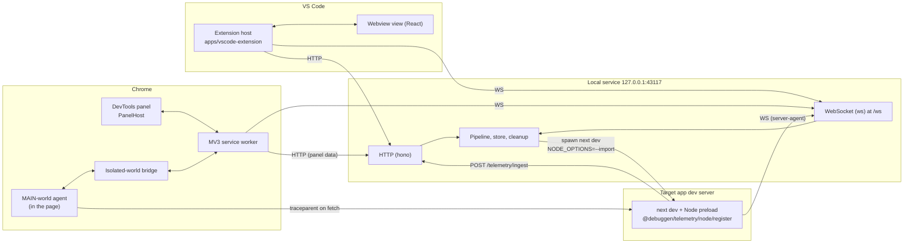
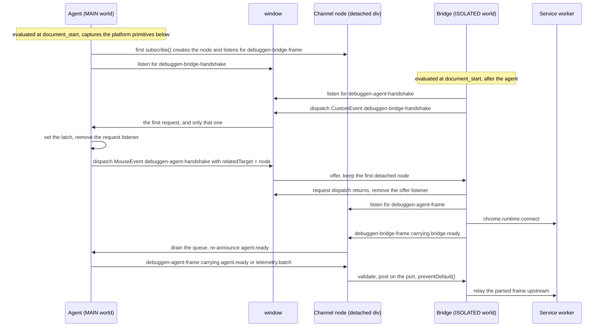
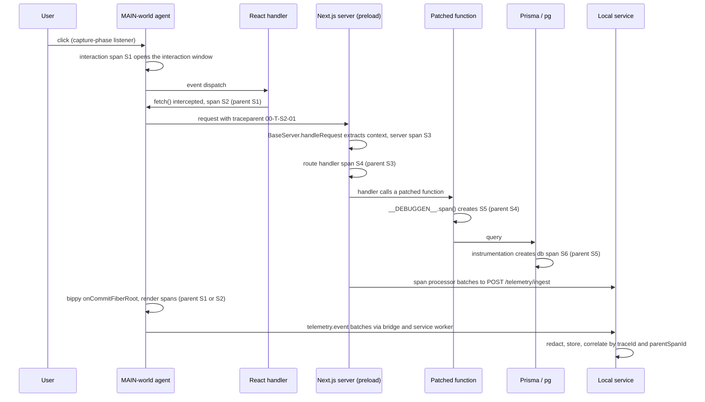
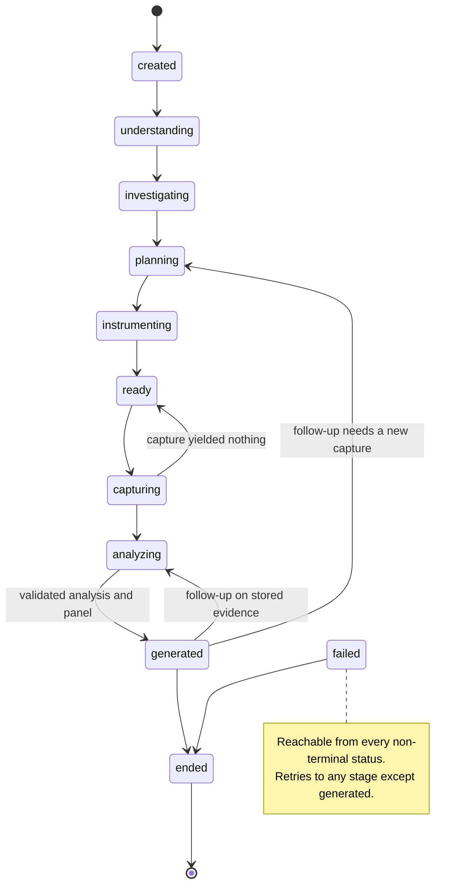

# Architecture

This is the structural reference for the Custom Debugging Generator monorepo: which process owns what, the contracts between them, and the decisions behind both. It is written from the code; where this document and a source file disagree, the source file is right and this document has a bug.

## Contents

1. [Purpose and scope](#1-purpose-and-scope)
2. [Components and process boundaries](#2-components-and-process-boundaries)
3. [Workspace layout and dependency layering](#3-workspace-layout-and-dependency-layering)
4. [Protocol](#4-protocol)
5. [Telemetry model](#5-telemetry-model)
6. [Trace correlation](#6-trace-correlation)
7. [Instrumentation model and reversibility](#7-instrumentation-model-and-reversibility)
8. [Session lifecycle and persistence](#8-session-lifecycle-and-persistence)
9. [AI stages and artifacts](#9-ai-stages-and-artifacts)
10. [Panel generation and the renderer contract](#10-panel-generation-and-the-renderer-contract)
11. [Source mapping](#11-source-mapping)
12. [Security boundaries](#12-security-boundaries)
13. [Extending the system: writing an adapter](#13-extending-the-system-writing-an-adapter)
14. [Key decisions](#14-key-decisions)

## 1. Purpose and scope

The product turns a plain-English debugging question about a React / Next.js / PostgreSQL project into a purpose-built, interactive panel inside Chrome DevTools. It reads the project's code, instruments the running application temporarily and reversibly, correlates what one interaction did across browser, server and database into one trace, and links runtime items back to their source line in VS Code wherever a location can be resolved — through the instrumentation patch record, the code graph and route map, source maps for generated chunks, or the React owner chain ([section 11](#11-source-mapping)). An item whose location cannot be established is shown as unresolved rather than linked to a guess. This document covers the processes, packages, contracts, data model, safety mechanisms and design decisions that make that work. It does not repeat setup: see [`README.md`](../README.md) for installation, configuration and troubleshooting, [`docs/DEMO.md`](DEMO.md) for the end-to-end walkthrough, and [`docs/SECURITY.md`](SECURITY.md) for the security and privacy model, which is authoritative wherever this document summarises it.

## 2. Components and process boundaries

Four processes cooperate. Each one owns a distinct set of responsibilities, and no process reaches into another's state: everything crosses a boundary as a validated message defined once in `@debuggen/protocol`.

| Process                                                                   | Owns                                                                                                                                                                                                                                                                                  | Entry points                                                                                                                                                                                        |
| ------------------------------------------------------------------------- | ------------------------------------------------------------------------------------------------------------------------------------------------------------------------------------------------------------------------------------------------------------------------------------- | --------------------------------------------------------------------------------------------------------------------------------------------------------------------------------------------------- |
| **VS Code extension host** + React webview view (`apps/vscode-extension`) | Editor actions: project-root detection, service lifecycle (starting the embedded service), question entry, progress display, the modifications list with diffs, open-at-source, the Sessions tree, Chrome pairing, the `vscode://` URI fallback                                       | `src/extension.ts` (host), `src/webview/main.tsx` (webview)                                                                                                                                         |
| **Local service** (`apps/local-service`, `127.0.0.1:43117`)               | Every session and its state machine, the `node:sqlite` store, code indexing, the six-stage pipeline, adapter-driven instrumentation, telemetry ingest / redaction / attribution / correlation, panel generation and validation, source-open forwarding, dev-server launching, cleanup | `src/main.ts`, built to `dist/main.js`                                                                                                                                                              |
| **Chrome MV3 extension** (`apps/chrome-extension`)                        | The service worker (authenticated WebSocket, tab↔session binding, arming the page agent, port routing), the `devtools_page`, the "Debug Generator" panel that hosts `PanelHost`, the isolated-world bridge, and the MAIN-world agent entry                                            | `src/background/service-worker.ts`, `src/devtools/devtools.ts`, `src/panel/main.tsx`, `src/content/bridge.ts`, `public/agent.iife.js` (copied from `packages/telemetry/dist/browser-agent.iife.js`) |
| **Target dev server** (the developer's `next dev`)                        | Running the developer's application, unmodified except for reversible patches, with the Node preload `@debuggen/telemetry/node/register` attached through `NODE_OPTIONS=--import`                                                                                                     | The project's own dev command, launched by `apps/local-service/src/dev-server/launcher.ts` or `pnpm demo:instrumented`                                                                              |



Two coupling rules keep these boundaries honest:

- **Both extensions import `@debuggen/protocol`, never service internals.** The VS Code extension talks to the service through the protocol's `ReconnectingWsClient` and `HttpClient` (`packages/protocol/src/client/`); the Chrome service worker builds and parses the same envelopes. Neither extension can name a module under `apps/local-service`, and ESLint refuses the import if one tries (section 3). The VS Code extension's build bundles the service into its VSIX, which is a packaging relationship, not an import.
- **Panel components never touch a transport.** Every visualization receives its data from `PanelHost` through the `DataProvider` interface (`packages/panel-renderer/src/host/DataProvider.ts`) and reports interactions through `PanelActions` (`src/host/PanelActions.ts`). A component never opens a socket and never calls `fetch`; the DevTools panel implements `DataProvider` over a runtime port to the service worker (`apps/chrome-extension/src/panel/data-provider.ts`), which proxies `POST /sessions/:id/panel-data`.

**Why the browser agent is a MAIN-world content script.** React commits are observed through the React DevTools global hook, and that hook must exist _before_ React loads or React never announces itself to it. Asking the developer to add a script to their application would modify the project the tool promises not to disturb. The manifest (`apps/chrome-extension/manifest.config.ts`) therefore declares two static `content_scripts` entries for the local app origins, both at `document_start`, in this order: `agent.iife.js` in the `MAIN` world, then `src/content/bridge.ts` in the default `ISOLATED` world. At `document_start` the agent only installs the hook (bippy's `install-hook-only` entry) and the `globalThis.__DEBUGGEN__` helper. It stays **dormant** — no listeners, no patched `fetch`, no fiber subscription — until the service worker relays an `agent.config` for the tab's session, and returns to dormant when a later `agent.config` clears every hook.

**How the preload finds the service.** The launcher (`apps/local-service/src/dev-server/launcher.ts`, or `scripts/dev-instrumented.mjs` behind `pnpm demo:instrumented`) appends `--import <preload>` to the child's `NODE_OPTIONS` and injects three variables: `DEBUGGEN_INGEST_URL` (the full ingest endpoint), `DEBUGGEN_TOKEN` (a `server-agent` credential scoped to this project) and `DEBUGGEN_PROJECT_ROOT`. They are minted per launch and are deliberately absent from `.env.example`; without a valid credential the preload stays inert. The service itself binds to `DEBUGGEN_HOST`:`DEBUGGEN_PORT`, `127.0.0.1:43117` by default; see [`README.md`](../README.md) for the full configuration reference.

## 3. Workspace layout and dependency layering

The repository is a pnpm workspace of twelve packages, with no path aliases to source: cross-package imports resolve through each package's `exports` map, which serves two readers. The runtime and every bundler follow the `import`/`default` conditions into the package's built `dist/`. TypeScript follows the `types` condition, which is source-first (`["./src/index.ts", "./dist/index.d.ts"]`): inside the repository it names the package's source barrel, which `tsc -b` replaces with the referenced project's `.tsbuild` declarations (built earlier in the same run) and the ESLint project service reads as source, so `pnpm typecheck` and `pnpm lint` depend neither on `pnpm build` having run nor on its freshness. The `dist/` entry applies only where `src/` is absent, as in a packed tarball (`files: ["dist"]`). `tsc -b` does not treat `package.json` as a build input, so after editing an `exports` map run `tsc -b --force` once.

| Workspace                  | Package                                  | Role                                                                                                                                         | Entry points                                                                                     | Build                                                                                                           | `@debuggen/*` dependencies                                                                                                 |
| -------------------------- | ---------------------------------------- | -------------------------------------------------------------------------------------------------------------------------------------------- | ------------------------------------------------------------------------------------------------ | --------------------------------------------------------------------------------------------------------------- | -------------------------------------------------------------------------------------------------------------------------- |
| `packages/shared`          | `@debuggen/shared`                       | Ids, `Result`, error codes, POSIX path containment, the `SourceLocation` schema, logger, time; `./node` adds SHA-256 hashing and `safe-fs`   | `src/index.ts`, `src/node/index.ts` (`./node`)                                                   | tsup                                                                                                            | none                                                                                                                       |
| `packages/telemetry`       | `@debuggen/telemetry`                    | The `TelemetryEvent` schema, redaction, correlation, aggregates; the browser agent; the Node preload                                         | `src/index.ts`, `src/browser/agent.ts` (IIFE bundle), `src/node/register.ts` (`./node/register`) | tsup, then `esbuild.agent.mjs` (`dist/browser-agent.iife.js`) and `esbuild.node.mjs` (`dist/node/register.mjs`) | shared                                                                                                                     |
| `packages/code-analysis`   | `@debuggen/code-analysis`                | ts-morph indexer, code graph and queries, route map, source-map resolver                                                                     | `src/index.ts`                                                                                   | tsup                                                                                                            | shared                                                                                                                     |
| `packages/instrumentation` | `@debuggen/instrumentation`              | Plan, target, modification and readiness schemas; the adapter contract and registry; six adapters; the patcher, installer and cleanup        | `src/index.ts`, `src/schema/index.ts` (`./schema`)                                               | tsup                                                                                                            | shared, telemetry, code-analysis                                                                                           |
| `packages/panel-schema`    | `@debuggen/panel-schema`                 | The panel DSL (authoring and normalized), the node catalog, syntactic and semantic validation                                                | `src/index.ts`                                                                                   | tsup                                                                                                            | shared, telemetry                                                                                                          |
| `packages/panel-renderer`  | `@debuggen/panel-renderer`               | Design tokens, primitives, layout, thirteen visualization components, `PanelHost`                                                            | `src/index.ts`, `./styles.css`                                                                   | tsup; `prebuild` regenerates `src/tokens/tokens.css` with `scripts/build-tokens.mjs`                            | shared, telemetry, panel-schema                                                                                            |
| `packages/model-provider`  | `@debuggen/model-provider`               | The `ModelProvider` interface, Anthropic and deterministic providers, structured output with repair, prompt loader, outbound redaction guard | `src/index.ts`                                                                                   | tsup                                                                                                            | shared                                                                                                                     |
| `packages/protocol`        | `@debuggen/protocol`                     | The message envelope, 28 WebSocket messages, 22 HTTP routes, `SessionRecord`, `AnalysisResult`, reconnecting clients                         | `src/index.ts`                                                                                   | tsup                                                                                                            | shared, telemetry, instrumentation, panel-schema                                                                           |
| `apps/local-service`       | `@debuggen/local-service`                | The coordination service                                                                                                                     | `src/main.ts`                                                                                    | tsup → `dist/main.js`                                                                                           | every package except panel-renderer                                                                                        |
| `apps/vscode-extension`    | `debug-generator` (publisher `debuggen`) | The editor surface                                                                                                                           | `src/extension.ts`, `src/webview/main.tsx`                                                       | `esbuild.mjs` (host bundle, embedded service, preload) and Vite (webview)                                       | protocol, panel-renderer, shared; `@debuggen/local-service` as a build-time dev dependency for the embedded service        |
| `apps/chrome-extension`    | `@debuggen/chrome-extension`             | The MV3 DevTools extension                                                                                                                   | `manifest.config.ts` and the entry points in section 2                                           | Vite with `@crxjs/vite-plugin`; `prebuild` runs `scripts/copy-agent.mjs`                                        | protocol, panel-schema, panel-renderer, shared; `@debuggen/telemetry` as a dev dependency so its agent bundle builds first |
| `apps/demo-app`            | `@debuggen/demo-app`                     | "Lumen Supply", the instrumentation target                                                                                                   | `app/` (App Router)                                                                              | Next.js; `prisma generate` runs before `build` and `typecheck`                                                  | none                                                                                                                       |

The package layering is acyclic and reads bottom to top:

```text
shared → telemetry → code-analysis → instrumentation & panel-schema → protocol → apps
                     panel-schema → panel-renderer        (model-provider depends on shared only)
```

The consequence that gives the layering teeth is that **`protocol` sits above the schema packages it embeds**. Its messages carry telemetry events, instrumentation plans and panel specifications, so it imports those packages, and nothing below it may import it back. That single rule decides where each shared type lives: `SourceLocation` is defined in `packages/shared/src/source-location.ts` so every layer can use it; `TelemetryEventIngress` and `TelemetryEvent` are defined in `packages/telemetry/src/schema/event.ts`; plans, modification records, readiness and the problem understanding are defined in `packages/instrumentation/src/schema/`; panel specifications in `packages/panel-schema/src/`. The browser agent, which lives in `packages/telemetry`, therefore cannot build protocol envelopes: it posts raw `{ events }` batches to the bridge, and the Chrome service worker (`apps/chrome-extension/src/background/ws-bridge.ts`) wraps them into `telemetry.event` frames. A type that crosses a process boundary is defined exactly once, and a second definition in an app is a defect.

The edge list is **enforced mechanically**, not merely documented:

- `eslint.config.js` carries one `no-restricted-imports` block per workspace, derived from a bottom-up package list, plus a block forbidding every package except `protocol` from importing `@debuggen/protocol`. Notable blocks: `apps/local-service` may import everything except `@debuggen/panel-renderer` (the service validates panels, it never renders them); `packages/model-provider` may import only `@debuggen/shared`, so no telemetry, plan or panel type can reach a model implicitly; `packages/telemetry/src/browser/**` may import only `@debuggen/shared` and no Node built-in; `apps/demo-app` may import neither `@debuggen/*` nor `@opentelemetry/*`. `pnpm lint` runs with `--max-warnings 0`, so a violation fails the gate.
- The root `tsconfig.json` is a `tsc -b` solution whose `references` list every project in the same bottom-up order, including the VS Code webview's second project (`apps/vscode-extension/tsconfig.webview.json`) and `tests/`. Every project extends `tsconfig.base.json` (`strict`, `noUncheckedIndexedAccess`, `exactOptionalPropertyTypes`, `verbatimModuleSyntax`, target ES2023).
- pnpm installs with strict isolation, so an undeclared dependency fails to resolve at runtime as well as at lint time.

**The demo application is deliberately isolated.** `apps/demo-app` is an instrumentation target: it declares no dependency on any `@debuggen/*` package and contains no product hooks, which is what makes an end-to-end run evidence that the tool works on an ordinary project. The reverse also holds: the product contains no knowledge of the demo. `scripts/check-no-hardcoding.mjs` (`pnpm check:no-hardcoding`) derives its forbidden-token policy (`scripts/no-hardcoding.policy.json`) from the demo's own code index, excluding only names that also occur in the independent fixture corpus `tests/fixtures/sample-next-app` and the reviewed generic vocabulary in `scripts/no-hardcoding.allowlist.json`. It parses product source with ts-morph and fails the build if a demo identifier or route path appears in product code, prompts or deterministic-provider templates, or if a comparison on the session question appears outside the understanding stage's generic tokenizer. It also reads repository tooling — the configuration files at the repository root and the files under `scripts/`, `.github/` and `.vscode/`, less the policy itself, the lockfile and test suites — as raw text, comments included, and fails on the same identifiers and routes there and on any path or glob that pins one concrete file of the demo (the demo tree, its directories, its root-level configuration and globs ending in a wildcard, such as `apps/demo-app/src/**/*.tsx`, stay allowed), so a tooling exception is expressed by workspace or rule and never records where the demo's defects live; that is documented only in `docs/DEMO.md`. The demo's defects can only be found by running the pipeline.

**The demo database has an incremental migration history.** Its schema is the Prisma 7 schema `apps/demo-app/prisma/schema.prisma` (twelve models), built by the migrations under `apps/demo-app/prisma/migrations/` in order: `0001_init`, the baseline that creates the twelve tables, and `0002_cart_checkout_key`, which adds the cart's checkout idempotency key column, unique, so a repeated checkout submission is answered with its first attempt's outcome instead of placing a second order. `pnpm demo:migrate` applies them with `prisma migrate deploy`, behind the `check:migration` gate (`apps/demo-app/prisma/check-migrations.ts`), which replays every committed migration in order and requires exactly the schema objects `prisma migrate diff --from-empty --to-schema prisma/schema.prisma` renders. An applied migration is never edited: a later schema change arrives as a new migration.

## 4. Protocol

### 4.1 Transports and the envelope

Conventional request/response traffic uses HTTP (hono). Push and streaming traffic uses one WebSocket endpoint on the same Node HTTP server, at `WS_PATH` = `/ws` (`packages/protocol/src/http.ts`).

Every WebSocket frame is the envelope `{ id, type, sessionId?, tabId?, ts, payload }`, validated on receipt by a Zod discriminated union on `type` (`packages/protocol/src/envelope.ts`: `parseMessage()`, `decodeMessage()`; frames are built with `createEnvelope()`). Validation is the receiver's job: `createEnvelope` is type-checked at compile time and does not re-validate, which keeps the high-volume `telemetry.event` path to one parse. The envelope's `sessionId` is the service's routing key; `createEnvelope` lifts it from the payload when the payload carries one and refuses an explicit value that contradicts it. The optional `tabId` is the acting tab: the Chrome service worker, which multiplexes every inspected tab over one socket, sets it on each frame it sends for a tab, and the service authorizes a DevTools frame only for the session whose live binding is that tab's (`packages/protocol/src/envelope.ts`; the HTTP counterpart is the `x-debuggen-tab` header). It is never lifted from a payload, and a frame whose `tabId` contradicts its payload's own `tabId` is refused.

The first frame on every socket is `client.hello { client, projectRoot?, tabId?, version, token }`, where `client` is one of `vscode`, `devtools`, `agent` or `server-agent` (`CLIENT_KINDS`). A connection that has not authenticated within `CLIENT_HELLO_TIMEOUT_MS` (3 s) is closed with code `4401` (`WS_CLOSE_UNAUTHORIZED`). The page agent holds no credential and no socket of its own: the service worker relays its frames under the tab's `devtools` connection, and a hello that claims `client: 'agent'` is refused.

### 4.2 WebSocket messages

The 28 message types are declared once, in `MESSAGE_TYPES` (`packages/protocol/src/messages/index.ts`). Paths below are relative to `packages/protocol/src/messages/`. Every payload is a `z.strictObject`, so an unknown key is a rejection, not a silently ignored field.

| Message                  | Sender → receiver                                                | Payload                                                                                                                                                                              | Defined in           |
| ------------------------ | ---------------------------------------------------------------- | ------------------------------------------------------------------------------------------------------------------------------------------------------------------------------------ | -------------------- |
| `client.hello`           | any socket client → service                                      | `{ client, projectRoot?, tabId?, version, token }`                                                                                                                                   | `agent.ts`           |
| `client.ping`            | any authenticated socket client → service                        | `{}`; the envelope `id` is the correlation key; answered on arrival with one `service.pong` to the sender alone, whatever its role; nothing else happens                             | `agent.ts`           |
| `service.pong`           | service → the pinging client alone                               | `{ ref }`; `ref` = the `id` of the `client.ping` answered; Chrome's heartbeat retires its socket when none arrives within `SERVICE_PONG_TIMEOUT_MS` (5 s)                            | `agent.ts`           |
| `agent.ready`            | page agent → bridge → service worker → service                   | `{ tabId, documentId, producerId, url, installedBeforeReact, reactDetected }`, sent at initialisation and after every reload                                                         | `agent.ts`           |
| `agent.config`           | service → service worker → bridge → page agent                   | `{ sessionId, captureId, hooks: AgentHookConfig }`; `hooks` = `interactions`, `react`, `state`, `fetch`, `perf`, `errors`, `componentTree`; all `false` returns the agent to dormant | `agent.ts`           |
| `server-agent.config`    | service → Node preload                                           | `{ sessionId?, captureId?, signals: ServerAgentSignals }`; `signals` = `http`, `routeHandlers`, `fetch`, `prisma`, `pg`, `functions[]`; no `captureId` disables the preload          | `agent.ts`           |
| `session.bind`           | DevTools panel (via the service worker) → service                | `{ tabId, url, origin, sessionId? }`                                                                                                                                                 | `binding.ts`         |
| `session.bound`          | service → DevTools, VS Code                                      | `{ sessionId, tabId, url, reason? }`; `reason` ∈ `bound`, `replaced`, `navigated`, `origin-changed`, `unbound`                                                                       | `binding.ts`         |
| `tab.navigated`          | service worker → service                                         | `{ tabId, url }` on every committed navigation                                                                                                                                       | `binding.ts`         |
| `session.unbind`         | DevTools panel or service worker → service                       | `{ tabId }` on DevTools close, tab close or session end                                                                                                                              | `binding.ts`         |
| `session.created`        | service → VS Code, DevTools                                      | `{ session: SessionRecord }`                                                                                                                                                         | `session.ts`         |
| `session.updated`        | service → VS Code, DevTools                                      | `{ session: SessionRecord }`                                                                                                                                                         | `session.ts`         |
| `session.progress`       | service → VS Code, DevTools                                      | `{ sessionId, stage, status, message, detail? }`; `stage` ∈ `PROGRESS_STAGES`, `status` ∈ `running`, `done`, `failed`                                                                | `session.ts`         |
| `analysis.completed`     | service → VS Code, DevTools                                      | `{ sessionId, analysis: AnalysisResult }`                                                                                                                                            | `session.ts`         |
| `capture.started`        | service → every client of the session                            | `{ sessionId, captureId }`                                                                                                                                                           | `capture.ts`         |
| `capture.stopped`        | service → every client of the session                            | `{ sessionId, captureId, summary: CaptureSummary }`                                                                                                                                  | `capture.ts`         |
| `instrumentation.plan`   | service → VS Code, DevTools                                      | `{ sessionId, plan: InstrumentationPlan }`                                                                                                                                           | `instrumentation.ts` |
| `instrumentation.ready`  | service → VS Code, DevTools                                      | `{ sessionId, applied: ModificationRecord[], runtimeHooks: string[], unavailable: { signal, reason, hint }[] }`                                                                      | `instrumentation.ts` |
| `instrumentation.failed` | service → VS Code, DevTools                                      | `{ sessionId, error: { code, message, ref?, hint } }`                                                                                                                                | `instrumentation.ts` |
| `telemetry.event`        | page agent → bridge → service worker (wraps the batch) → service | `{ events: TelemetryEventIngress[] }`                                                                                                                                                | `telemetry.ts`       |
| `telemetry.tail`         | service → DevTools                                               | `{ sessionId, events: TelemetryEvent[] }`, already redacted                                                                                                                          | `telemetry.ts`       |
| `panel.generated`        | service → DevTools, VS Code                                      | `{ sessionId, panelId, panel: PanelSpec }`                                                                                                                                           | `panel.ts`           |
| `source.open`            | DevTools (via the service worker) → service → VS Code            | `{ sessionId, location: SourceLocation }`; to VS Code the service adds `pinned: { file, dev, ino }`, the canonical file it proved, and refuses an inbound frame carrying it          | `source.ts`          |
| `source.result`          | VS Code → service → DevTools (via the service worker)            | `{ sessionId, ref, status, error? }`; `ref` = the `id` of the `source.open` answered; `status` ∈ `opened`, `no-editor`, `failed`; `error` = `{ code, message, hint? }` when `failed` | `source.ts`          |
| `target.request`         | service → the session's bound DevTools tab only                  | `{ sessionId }`: enter element-picker mode; pushed only in answer to the editor's `POST /sessions/:id/target/request`, and refused when a client sends it                            | `target.ts`          |
| `target.selected`        | DevTools → service                                               | `{ sessionId, target: SelectedTarget }`; `SelectedTarget` = `{ selector, tagName, text?, componentChain, url }`; refused or accepted as below                                        | `target.ts`          |
| `cleanup.completed`      | service → VS Code, DevTools                                      | `{ sessionId, status, conflicts: ModificationConflict[] }`                                                                                                                           | `cleanup.ts`         |
| `error`                  | service → any client                                             | `{ code, message, ref? }`; `code` is drawn from the closed `DEBUGGEN_ERROR_CODES` set in `@debuggen/shared`                                                                          | `error.ts`           |

A `target.selected` frame that has been sent or queued is pending, never accepted. The service refuses it with an `error` whose `ref` is the frame's envelope `id` — `TAB_NOT_BOUND` when the sender's tab is not bound to that session, or when `compareSelectionDocument` finds the descriptor's `url` is not of the bound tab's current document (same origin and path; query and fragment ignored) — or accepts it by recording the target, which the session manager announces as the `session.updated` whose `session.target` satisfies `sameSelectedTarget` with the sent descriptor. Both helpers are in `target.ts`. A frame lost to eviction or a closed socket gets neither answer, so the sender retracts it.

`session.progress` stages are `understand`, `investigate`, `plan`, `instrument`, `capture`, `analyze`, `generate-panel`, `followup` and `cleanup`. They are a different vocabulary from the session statuses of section 8: a stage reports work, a status is where the state machine stands.

### 4.3 HTTP routes

The route table is `HTTP_ROUTES` in `packages/protocol/src/http.ts`: twenty-two operations, each with its method, path pattern, request schema and response schema, and helpers (`buildPath`, `parseHttpRequest`, `parseHttpResponse`) so no client spells a path by hand. Five operation ids — `session.create`, `session.question`, `session.end`, `capture.start`, `capture.stop` — are the user's own message names; they are **HTTP operations, not WebSocket message types**, and a compile-time assertion keeps them out of `MESSAGE_TYPES`. `telemetry.event` is legitimately both: a WebSocket message for the browser tier and the operation id of the ingest route for the server tier, with the same event schema.

| Operation id           | Route                               | Caller                                            | Request → response                                                                                                                                         |
| ---------------------- | ----------------------------------- | ------------------------------------------------- | ---------------------------------------------------------------------------------------------------------------------------------------------------------- |
| `session.create`       | `POST /sessions`                    | VS Code                                           | `{ projectRoot, question, target?, devServerUrl? }` → `SessionRecord`                                                                                      |
| `session.list`         | `GET /sessions`                     | VS Code (Sessions tree)                           | `?limit&offset` → one page, newest first: `{ sessions: SessionListItem[], total, limit, offset, nextOffset }`                                              |
| `session.get`          | `GET /sessions/:id`                 | VS Code (reopen)                                  | → `SessionRecord`                                                                                                                                          |
| `session.question`     | `POST /sessions/:id/question`       | VS Code                                           | `{ question, attemptId? }` (a follow-up; a Retry resends its attempt id) → `SessionRecord`                                                                 |
| `session.end`          | `POST /sessions/:id/end`            | VS Code, including on deactivation                | `{}` → `{ cleanup: CleanupStatus }`                                                                                                                        |
| `session.purge`        | `POST /sessions/purge`              | VS Code (`debuggen.purgeSessions`)                | `{}` → the retention sweep's counts, `cutoff`, `durationMs`, `issueCount` and the aged sessions kept for conflicts (at most 100 ids, plus their total)     |
| `capture.start`        | `POST /sessions/:id/capture/start`  | VS Code or DevTools                               | `{}` → `{ captureId }`, or `409` (section 4.6)                                                                                                             |
| `capture.stop`         | `POST /sessions/:id/capture/stop`   | VS Code or DevTools                               | `{}` → `{ summary: CaptureSummary }`                                                                                                                       |
| `target.request`       | `POST /sessions/:id/target/request` | VS Code                                           | `{}` → `{ sessionId, tabId }`, or `409 TAB_NOT_BOUND` / `503 TRANSPORT_DISCONNECTED`                                                                       |
| `panel.data`           | `POST /sessions/:id/panel-data`     | DevTools (proxied by the service worker), VS Code | `DataQuery` → `DataResult` (section 4.5)                                                                                                                   |
| `panel.get`            | `GET /sessions/:id/panel`           | DevTools, VS Code                                 | → `{ panel: PanelSpec \| null }`, the current version                                                                                                      |
| `panel.getById`        | `GET /sessions/:id/panels/:panelId` | DevTools, VS Code                                 | → `{ panel: PanelSpec }`, one stored version                                                                                                               |
| `modifications.list`   | `GET /sessions/:id/modifications`   | DevTools, VS Code                                 | `?limit&offset` → one page bounded by count and diff bytes: `{ modifications: ModificationRecord[], total, limit, offset, nextOffset }`                    |
| `telemetry.event`      | `POST /telemetry/ingest`            | Node preload                                      | `{ projectRoot, events, armedCaptureId?, droppedCount?, lossReportId? }`: ≤ 5 000 ingress events, `[]` only as a loss report → `{ accepted, rejected? }`   |
| `devServer.launch`     | `POST /dev-server/launch`           | VS Code, `pnpm demo:instrumented`                 | `{ projectRoot, command? }` → `{ devServerUrl, pid }`                                                                                                      |
| `devServer.stop`       | `POST /dev-server/stop`             | VS Code, `pnpm demo:instrumented`                 | `{ projectRoot }` → `{ stopped }`                                                                                                                          |
| `devServer.credential` | `POST /dev-server/credential`       | `pnpm demo:instrumented`                          | `{ projectRoot }` (absolute, inside an announced workspace folder) → `{ token, expiresAt }`, a `server-agent` lease renewed while its preload is connected |
| `health`               | `GET /health`                       | anyone (no credential)                            | → `{ version, protocolVersion, pairingAvailable }`; a challenged probe also gets an identity proof                                                         |
| `pair.start`           | `POST /pair/start`                  | VS Code                                           | `{}` → `{ code, expiresAt }`                                                                                                                               |
| `pair.complete`        | `POST /pair/complete`               | Chrome service worker (no credential)             | `{ code }` → `{ token }`                                                                                                                                   |
| `credentials.rotate`   | `POST /credentials/rotate`          | VS Code (`debuggen.rotateServiceToken`)           | `{}` → `{ credentialsDeleted, socketsClosed }`, answered after every socket was closed with 4401                                                           |
| `credentials.release`  | `POST /credentials/release`         | `pnpm demo:instrumented`, as its dev server exits | `{ token }` → `{ released }`: `true` when that `devServer.credential` credential was live and is now revoked (its sockets closed with 4401), else `false`  |

The table is the service's whole HTTP surface: `apps/local-service/src/server/http.ts` registers exactly these twenty-two operations, and nothing beside them. Four are administrative and accept only the editor credential: `session.purge` runs the retention sweep (section 8.4), `devServer.credential` mints a `server-agent` credential for a dev server the caller starts itself, `credentials.release` revokes such a credential early at its holder's request — never a launched dev server's own, and with the same `{ released: false }` for every credential it did not revoke — and `credentials.rotate` rotates every credential (section 12).

### 4.4 Tab/session binding

A session is created from VS Code with a `projectRoot` and the project's dev-server URL (probed or launched). When the "Debug Generator" panel opens, it announces its inspected `tabId`, current URL and origin with `session.bind`. The service (`apps/local-service/src/server/routes/binding.ts`) binds the tab to the session whose dev-server origin matches — or, if the panel names a `sessionId`, to that session after checking the origin — and answers `session.bound`. The binding is the deterministic recipient for `agent.config`, `target.request`, `telemetry.tail` and `panel.generated`, and it supplies the understanding stage's "current URL" when no element is selected.

The service worker reports `tab.navigated` on every committed navigation. A same-origin navigation keeps the binding, records the new URL and re-arms the agent, whose new document started dormant; a navigation to a different origin drops the binding (`reason: 'origin-changed'`) and the panel tells the developer the tab left the app's origin. One tab binds to at most one session, and one session accepts one bound tab at a time: a second bind replaces the first and is announced with `reason: 'replaced'`. `session.end`, closing DevTools and closing the tab all unbind. `apps/local-service/test/integration/binding.test.ts` pins these rules.

### 4.5 Panel data

Panel components never receive bulk telemetry in a message. Each visualization node carries a `DataQuery`, and the renderer resolves it on demand with `POST /sessions/:id/panel-data`, served by `apps/local-service/src/panels/data.ts` from the telemetry repository and the aggregates in `packages/telemetry/src/aggregate/`. The response is a `DataResult` discriminated on `source`:

| `source`           | Result shape                                                                                   | Defined in                                     |
| ------------------ | ---------------------------------------------------------------------------------------------- | ---------------------------------------------- |
| `trace`            | `TraceTree` (one correlated tree)                                                              | `packages/telemetry/src/correlation/tree.ts`   |
| `spans`, `events`  | `TelemetryEvent[]`                                                                             | `packages/telemetry/src/schema/event.ts`       |
| `renders`          | `RenderStat[]`: per-component counts, total and average time, trigger histogram, changed props | `packages/telemetry/src/aggregate/renders.ts`  |
| `componentTree`    | `ComponentTreeSnapshot`, taken at the capture's last commit                                    | `packages/telemetry/src/aggregate/renders.ts`  |
| `requests`         | `RequestGroup[]`, including duplicate groups                                                   | `packages/telemetry/src/aggregate/requests.ts` |
| `queries`          | `QueryGroup[]`, grouped by normalised statement                                                | `packages/telemetry/src/aggregate/queries.ts`  |
| `stateTransitions` | `StateTransition[]`                                                                            | `packages/telemetry/src/aggregate/timeline.ts` |
| `graph`            | `DependencyGraphData`                                                                          | `packages/telemetry/src/aggregate/timeline.ts` |
| `metrics`          | `MetricValue[]`                                                                                | `packages/telemetry/src/aggregate/summary.ts`  |

`filter` narrows (`traceId`, `kinds`, `component`, `tier`, `minDuration`); `sort` (`duration_desc`, `start_asc`, `count_desc`) orders with a stable secondary key per source; `limit` (default 200, maximum 5 000) and `offset` (default 0) page the array-valued sources, and the response carries `total` and `nextOffset`. `apps/local-service/test/integration/panel-data.test.ts` walks a multi-page result for every source.

### 4.6 Capture exclusivity

The Node preload in a dev server can serve only one capture at a time, so at most one session may hold a capture on a project. `apps/local-service/src/sessions/manager.ts` enforces it: a `capture.start` for a project whose dev server another session is already capturing answers `409` with error code `CAPTURE_ALREADY_ACTIVE` and `{ owningSessionId }`, and `server-agent.config` always names the single owner. `apps/local-service/test/integration/concurrency.test.ts` covers the conflict.

### 4.7 The page↔bridge channel

The MAIN-world agent has no extension APIs, and the isolated-world bridge shares the page's DOM but not its JavaScript realm. `packages/telemetry/src/browser/transport.ts` defines the channel between them — the node, the handshake, the frame shape, both type vocabularies, the size cap and the channel version — and `apps/chrome-extension/src/shared/messages.ts` mirrors those literals for `apps/chrome-extension/src/content/bridge.ts`. The channel is one `div` the agent creates with a captured `Document.prototype.createElement` and never inserts into the document. Every frame is a `CustomEvent` dispatched on that node, and a node with no parent has no propagation path: the event reaches the listeners on that node and nothing else — not `window`, not `document`, not a capture-phase listener a page installed anywhere. Observing or injecting a frame therefore requires a reference to the node, and exactly one is handed out.



**Handshake.** The manifest injects the agent and then the bridge, both at `document_start` (section 2), so the agent's request listener exists before the bridge asks and before any page script runs. The bridge registers its offer listener, dispatches the request on `window` and removes the listener as soon as that dispatch returns: the agent answers synchronously inside it, and nothing arriving later may be believed. The agent answers the first request only. It sets its latch and removes its request listener _before_ dispatching the answer, so a handler that dispatches a second request from inside the first answer finds the exchange closed, and neither a transport reset nor a re-subscribe re-opens it. The answer is a `MouseEvent` whose `relatedTarget` is the node: `relatedTarget` is the standard event field that carries a node, and a DOM node is the one value both worlds see as the same underlying object. The bridge keeps the first `relatedTarget` that is not `window`, has `addEventListener`, `removeEventListener` and `dispatchEvent`, and is not connected to the document — a connected node is one any page script can find with a query. No offer is ever sent unsolicited.

**Frames.** Both directions use a non-bubbling, cancelable `CustomEvent` on the node whose `detail` is the JSON **string** `{ source, version, type, payload }`, because a primitive crosses the world boundary unchanged.

|                          | Agent → bridge                                                                                                                                                                                                                                                                         | Bridge → agent                                                                                                     |
| ------------------------ | -------------------------------------------------------------------------------------------------------------------------------------------------------------------------------------------------------------------------------------------------------------------------------------- | ------------------------------------------------------------------------------------------------------------------ |
| Event                    | `debuggen-agent-frame` (`AGENT_FRAME_EVENT`)                                                                                                                                                                                                                                           | `debuggen-bridge-frame` (`BRIDGE_FRAME_EVENT`)                                                                     |
| `source`                 | `debuggen-agent`                                                                                                                                                                                                                                                                       | `debuggen-bridge`                                                                                                  |
| `type`                   | `agent.ready`, `telemetry.batch`, `target.described`, `agent.error`                                                                                                                                                                                                                    | `bridge.ready`, `bridge.gone`, `bridge.pause`, `bridge.resume`, `agent.config`, `agent.snapshot`, `target.request` |
| Rendered by              | `serializeFrameJson`: the text `JSON.stringify` would produce, with no `toJSON` consulted and no getter run                                                                                                                                                                            | `renderPageFrame` in `shared/messages.ts`, with `JSON.stringify` from the bridge's own isolated world              |
| Accepted by the receiver | `shouldAcceptAgentFrame` in `bridge.ts`: the shape checks below, then each payload against the shared vocabularies, the `documentId` and `producerId` pinned by the first `agent.ready`, a `batchSeq` that strictly increases within a capture, and the per-document event-rate budget | the agent's listener: the shape checks below, the parse revived into null-prototype objects                        |

The shape checks are the same in both directions: the `detail` is a string of at most `MAX_MESSAGE_BYTES` (512 × 1024) code units, measured before parsing; it parses to a plain object; `source` is the sender's tag; `version` equals `CHANNEL_VERSION` exactly, so an agent and a bridge from different builds ignore each other until the page reloads; and `type` belongs to the sender's vocabulary. The bridge's mirrors of the two constants are `MAX_PAGE_FRAME_LENGTH` and `PAGE_CHANNEL_VERSION`. A receiver that accepts a frame calls `preventDefault()`, and the sender reads `dispatchEvent` returning `false` as "claimed". Dispatch is synchronous, so the answer exists before `dispatchEvent` returns. The agent drops a refused frame silently and leaves it unacknowledged. The bridge acknowledges a frame once its runtime port has taken it or once it has refused the frame for good, and leaves it unacknowledged when it has no port or the post throws. An unclaimed telemetry batch goes back to the front of the agent's queue — the only buffer, `MAX_BUFFERED_EVENTS` (5 000 events, drop-oldest) — and is delivered after the next `bridge.ready`, which the bridge sends once it has the node and a live port and again after every service-worker reconnect.

**Flow control (channel version 4).** Telemetry is paced end to end rather than dropped where it backs up. The local service yields a macrotask after every ingested batch (`apps/local-service/src/telemetry/ingest.ts`), so one connection's backlog never starves `/health` or another socket's pings, and pauses reading a socket whose unprocessed frames pass a byte or frame watermark, resuming once they drain (`apps/local-service/src/server/ws.ts`; the `1013` close stays as the last resort). The service worker bounds the telemetry it has written but the service has not yet processed: a `client.ping` barrier every few frames acknowledges everything before it, and a tab's lane awaits capacity in that window before sending (`awaitTelemetryCapacity` in `background/ws-bridge.ts`). When a tab's lane backs up past a quarter of its bound the worker relays `bridge.pause` to that tab's bridge, and `bridge.resume` once it has drained; between the two the agent posts no batch of its own accord and keeps buffering in its ring, so sustained overload surfaces as counted, drop-oldest `droppedCount` loss on the next batch rather than as a disconnect. Terminal drains (`pagehide`, a hidden document, capture stop, a capture change) still post, and a pause is cleared by a new port. Both signals are consumed by the transport and never reach `./agent.ts`, so a resume re-sends no `agent.ready`. The agent also keeps its own volume down: `packages/telemetry/src/browser/react.ts` defers diffing and trigger inference out of React's commit to idle slices and emits one render event per group of a component's fibers that rendered alike in one commit, carrying `instanceCount` and `maxInstanceDuration`; `aggregate/renders.ts` weights every count by it.

**Why each primitive is captured.** The agent shares the page's realm, so every built-in it calls after `document_start` is whatever the page has since put there, and a replacement receives the call's arguments. The channel's primitives are therefore read once, while the agent bundle is evaluated at `document_start` before any page script, and every one is called only through the captured `Reflect.apply`:

| Primitive                                                                                                                      | What a page replacement would otherwise gain                                                                                      |
| ------------------------------------------------------------------------------------------------------------------------------ | --------------------------------------------------------------------------------------------------------------------------------- |
| `Reflect.apply`                                                                                                                | nothing to intercept: a replaced `Function.prototype.call` or `apply` is never involved                                           |
| `EventTarget.prototype.addEventListener`, `removeEventListener`, `dispatchEvent`, and the same three as `window` resolves them | a wrapped `dispatchEvent` would receive every frame; a wrapped `addEventListener` would receive the node and the agent's listener |
| the `CustomEvent` and `MouseEvent` constructors                                                                                | each frame's `detail`, or the node itself in the handshake answer                                                                 |
| the `CustomEvent.prototype.detail` getter                                                                                      | inbound text of the page's choosing, handed to the agent's listener                                                               |
| `Event.prototype.preventDefault`                                                                                               | control of the acknowledgement, and with it of which frames count as delivered                                                    |
| `JSON.parse`                                                                                                                   | every inbound frame's text, and the choice of what it parses to                                                                   |
| `Document.prototype.createElement`                                                                                             | a reference to the node as it is created, or a node of the page's own in its place                                                |
| `Object.create`, `Object.keys`, `Array.isArray`                                                                                | the parsed frame, as the reviver copies it into null-prototype records                                                            |

The three handshake methods are read off `window` itself, as `window` resolves them at that moment; in a browser they are the `EventTarget.prototype` functions, and the separate read keeps the handshake working in a host whose global object forwards to an `EventTarget`. Two composition rules complete the set. Event init dictionaries are null-prototype records, because a constructor reads the members a dictionary lacks, and on an ordinary object those reads reach `Object.prototype`, where a page's getter would be handed the dictionary and with it the frame's `detail` or the node. Outbound frames are composed by defining own properties and rendered by `serializeFrameJson`, so no setter, getter or `toJSON` a page installs ever sees one. Beyond the channel, the agent's control path — frame receipt, subscriber delivery, configuration parsing and the arm/disarm decisions — runs on separately captured language intrinsics, null-prototype storage and operators ("Core intrinsics and page-proof primitives" in `transport.ts`), so no replaceable built-in is handed the handler that applies an `agent.config`.

No in-page design defends against code that ran before the agent (another extension's MAIN-world `document_start` script, an automation tool's init script, a modified browser), which can replace the primitives first or take the node from the handshake answer. On a page with no bridge, a page script can ask first and hold the node, and then drives an agent with no session, no capture, no service and no network egress of its own. The page also controls its own behaviour, clock and scheduler, so MAIN-world telemetry is evidence about what the page did rather than a tamper-proof measurement, and the service treats every field of it as untrusted input (section 12).

**Decision: the channel carries no shared secret.** Authority is possession of the node, which only the agent and the bridge hold. A token presented on frames dispatched on `window` would be readable by every page listener from the first frame on, and anyone holding it could replay an all-false `agent.config`, which returns the agent to dormant, indistinguishable from the bridge's. A private node closes both paths at once: page scripts can neither observe the bridge's frames nor inject their own, and nothing has to stay secret from a page that can read everything on `window`. This rules out `window.postMessage` and any token-authenticated frame on `window` as the page hop.

## 5. Telemetry model

### 5.1 One record for every tier

Every runtime signal — a click, a React commit, a fetch, a Next.js request, a patched function, a SQL query — is the same span-shaped record, defined once in `packages/telemetry/src/schema/event.ts`. There are two schemas over the same fields, because producers and the store know different things:

| Schema                  | Written by                                           | Adds                                                                                                     |
| ----------------------- | ---------------------------------------------------- | -------------------------------------------------------------------------------------------------------- |
| `TelemetryEventIngress` | every producer: browser agent and Node preload alike | nothing; a producer knows neither the session nor the capture it belongs to                              |
| `TelemetryEvent`        | the service, at ingest                               | `sessionId`, `captureId` and `ingestSeq` (a store-assigned, monotonically increasing integer, one-based) |

Keeping session and capture out of the ingress schema means attribution is always the service's decision (`apps/local-service/src/telemetry/attribute.ts`), never a producer's claim.

| Field           | Type                               | Notes                                                                      |
| --------------- | ---------------------------------- | -------------------------------------------------------------------------- |
| `id`            | string                             | unique event id                                                            |
| `traceId`       | 32 lowercase hex                   | W3C trace id                                                               |
| `spanId`        | 16 lowercase hex                   | W3C span id                                                                |
| `parentSpanId`  | 16 lowercase hex, optional         | absent on a trace root                                                     |
| `kind`          | one of the 17 kinds below          | `KIND_ALLOWED_TIERS` in `schema/kinds.ts` rejects a kind on the wrong tier |
| `name`          | string                             | display name                                                               |
| `startTime`     | number                             | Unix epoch milliseconds (section 5.2)                                      |
| `duration`      | number                             | milliseconds                                                               |
| `tier`          | `browser` \| `server` \| `db`      |                                                                            |
| `attributes`    | record                             | kind-specific keys declared in `schema/attributes.ts`                      |
| `status`        | `unset` \| `ok` \| `error`         |                                                                            |
| `producerId`    | string                             | random per page document (agent) or per process (preload)                  |
| `seq`           | integer                            | zero-based, monotonic per producer and scoped to `(producerId, captureId)` |
| `clockOffsetMs` | integer, optional                  | the producer's clock-offset estimate, informational only (section 5.2)     |
| `source`        | `SourceLocation`, optional         | set when the event can be linked to code (section 11)                      |
| `redacted`      | array of attribute paths, optional | which attributes the redaction layer rewrote                               |

### 5.2 Time base

`startTime` is Unix epoch **milliseconds** as a double with sub-millisecond precision, and `duration` is milliseconds, on both tiers. The browser agent computes `performance.timeOrigin + entry.startTime`; the Node exporter converts OpenTelemetry `hrTime` to epoch milliseconds (`packages/telemetry/src/node/convert.ts`). Both producers run on the developer's machine against the same clock, so no clock alignment is applied: the service stores both values exactly as the producer stamped them.

What each producer does record is an informational estimate of its own clock's offset, the optional `clockOffsetMs` field: server clock minus producer clock, in whole milliseconds, so a positive value means the server's clock is ahead. The estimator is `ClockOffsetEstimator` in `packages/telemetry/src/schema/clock-offset.ts`. An HTTP `Date` header has one-second resolution and was written somewhere between the producer sending the request and receiving the response, so one response confines the offset to the interval `[D − receivedAt, D + 1000 − sentAt]`; the estimator intersects the intervals of successive responses, reports the midpoint rounded to a whole millisecond, restarts from the newest sample when an interval is disjoint from the current one (a clock step), and rejects a sample whose round trip exceeds ten seconds or whose interval reaches more than one day either way (`CLOCK_OFFSET_BOUND_MS`). There are two acquisition paths:

- **Browser agent.** `packages/telemetry/src/browser/fetch.ts` feeds `observeServerClock(date, sentAt, receivedAt)` in `packages/telemetry/src/browser/transport.ts` from the same-origin fetch and XHR responses its hooks observe — the dev server's `Date`, measured against the agent's own clock, `performance.timeOrigin + performance.now()`; a response carrying an `Age` header came from a cache and is skipped. `getClockOffsetStats()` exposes the estimator's state.
- **Node preload.** `DebuggenSpanProcessor` in `packages/telemetry/src/node/exporter.ts` samples the local service's `Date` on the answers to its own `POST /telemetry/ingest` requests against `Date.now()`, and `clockOffset()` exposes the estimator's state.

Each producer stamps its current estimate once, when it creates an event, so an event re-sent after a reconnect is identical to its first delivery; the field is absent until the producer's first usable sample. At ingest the ingress schema accepts only a whole number of milliseconds within ±86 400 000, and an event carrying anything else is counted invalid. `apps/local-service/src/telemetry/ingest.ts` never applies or re-derives the offset; it counts the events that reported one. The store projects the value into `telemetry_events.clock_offset_ms` (store schema version 5, added by `apps/local-service/src/store/migrations.ts`; `NULL` when the event carried none), and `listProducerClockOffsets` in `apps/local-service/src/store/telemetry-repo.ts` summarises it per capture and producer: the latest reported offset, the minimum and maximum, the number of reporting events and their tiers. That summary answers whether two producers' timestamps can be compared at the precision a timeline draws them.

### 5.3 Kinds and attributes

The seventeen `kind` values, from `packages/telemetry/src/schema/kinds.ts`:

| Allowed tier(s)   | Kinds                                                                                                            |
| ----------------- | ---------------------------------------------------------------------------------------------------------------- |
| browser only      | `interaction`, `render`, `commit`, `fetch`, `xhr`, `navigation`, `perf.longtask`, `perf.entry`, `error`, `state` |
| server only       | `http.server`, `route.handler`, `http.client`, `server.error`                                                    |
| browser or server | `function` (patched function timing runs on either tier), `log`                                                  |
| db only           | `db.query`                                                                                                       |

The authoritative tier mapping is `KIND_ALLOWED_TIERS`; the table is its reading. Kind-specific attribute keys are declared once in `packages/telemetry/src/schema/attributes.ts`, for example:

| Kind       | Attribute keys                                                 |
| ---------- | -------------------------------------------------------------- |
| `render`   | `component`, `phase`, `renderCount`, `changedProps`, `trigger` |
| `commit`   | `phase`, `renderCount`, `rootName`                             |
| `fetch`    | `http.method`, `url`, `http.status_code`, `initiator`          |
| `db.query` | `db.system`, `db.statement`, `db.rowCount`                     |

The same file declares the correlation keys the service and the browser agent stamp onto events: `lineage`, `lineageAmbiguous`, `lineageCandidates` (section 6.3) and `orphaned`, `orphanedParentSpanId` (section 6.4).

### 5.4 Ordering

Within a trace the canonical order is, in this precedence:

1. parent before child (structural);
2. `startTime`;
3. `(producerId, seq)`;
4. `ingestSeq`, the final and always-distinct tie-breaker.

The correlator (`packages/telemetry/src/correlation/correlator.ts`) is pure and permutation-invariant: any arrival order of the same events yields the same tree. `packages/telemetry/src/correlation/correlator.test.ts` covers mixed browser and Node inputs, including equal timestamps across producers.

### 5.5 Computed metrics

Metric cards and the analysis stage read a fixed set of metric ids (`METRIC_IDS` in `schema/attributes.ts`), all computed by `packages/telemetry/src/aggregate/summary.ts` into the `CaptureSummary`:

| Metric id                               | Definition (`METRIC_DEFINITIONS`)                                                                                                                       |
| --------------------------------------- | ------------------------------------------------------------------------------------------------------------------------------------------------------- |
| `total_duration`                        | latest `startTime + duration` minus earliest `startTime` of the events in scope                                                                         |
| `backend_duration`, `database_duration` | interval **union** of the server-tier and database-tier spans, so parallel work counts once                                                             |
| `frontend_duration`                     | union of browser intervals minus the union of server intervals, so time awaiting the server is not counted twice                                        |
| `render_count`                          | renders observed across every component                                                                                                                 |
| `unchanged_render_count`                | renders whose props were shallow-equal, own hook state unchanged **and** consumed context values unchanged                                              |
| `render_trigger_unknown_count`          | renders whose trigger could not be determined — counted apart, never folded into unchanged                                                              |
| `request_count`                         | requests issued, per occurrence                                                                                                                         |
| `duplicate_request_count`               | redundant occurrences: those past the first in each duplicate window                                                                                    |
| `query_count`                           | database statements executed                                                                                                                            |
| `transferred_bytes`                     | sum of reported `PerformanceResourceTiming.transferSize`; unavailable (never `0`) when nothing reported one, since only same-origin responses expose it |
| `blocking_time`                         | each long task's duration beyond 50 ms (`LONG_TASK_BLOCKING_THRESHOLD_MS`), summed                                                                      |
| `long_task_count`                       | long tasks the performance timeline reported                                                                                                            |
| `error_count`                           | events that are failures by kind or carry an error status                                                                                               |

The invariants `frontend_duration + backend_duration <= total_duration` and, when both tiers are captured, `database_duration <= backend_duration` follow from the union arithmetic.

The render trigger is classified by `packages/telemetry/src/browser/fiber-diff.ts` by comparing each fiber with its alternate: props changed → `props`, own hook state changed → `state`, a consumed context value changed → `context`, none changed → `unchanged`, and `unknown` when any of the three cannot be evaluated. Only `unchanged` feeds `unchanged_render_count`.

## 6. Trace correlation

### 6.1 One interaction, one tree

The correlation identifier is created at the browser interaction and carried across every seam, so a single click resolves to one ordered tree spanning the browser handler, React work, the fetch, the Next.js route handler, service functions, SQL and outbound calls. The mechanism is OpenTelemetry's: W3C Trace Context and the span model, not a bespoke protocol.



### 6.2 The seams

| Seam                      | Mechanism                                                                                                                                                                                                                                         | File                                                                                         |
| ------------------------- | ------------------------------------------------------------------------------------------------------------------------------------------------------------------------------------------------------------------------------------------------- | -------------------------------------------------------------------------------------------- |
| click → interaction span  | capture-phase listener plus a `PerformanceObserver('event')` for handler timing; the synchronous window closes after the event's `processingEnd` plus a bounded 50 ms tail (`INTERACTION_TAIL_MS`) for microtask-scheduled requests               | `packages/telemetry/src/browser/interaction.ts`                                              |
| browser → server          | the agent's fetch/XHR patch injects `traceparent` on **same-origin** requests while an interaction or continuation window is active, and records the initiator stack                                                                              | `packages/telemetry/src/browser/fetch.ts`                                                    |
| request → server span     | Next.js's own request tracer extracts the incoming context once `NodeTracerProvider.register()` has installed the global W3C propagator; the default `AsyncLocalStorage` context manager carries it through the handler                           | `packages/telemetry/src/node/register.ts`                                                    |
| server → patched function | `globalThis.__DEBUGGEN__.span` starts a child of the active span with `trace.getTracer` and `context.with`                                                                                                                                        | `packages/telemetry/src/node/span-helper.ts`                                                 |
| server → database         | `@prisma/instrumentation` and `@opentelemetry/instrumentation-pg`, registered by the preload                                                                                                                                                      | `packages/telemetry/src/node/register.ts`                                                    |
| server → service          | a custom span processor converts each `ReadableSpan` to `TelemetryEventIngress` and batches it to `POST /telemetry/ingest` with the server-agent credential                                                                                       | `packages/telemetry/src/node/exporter.ts`, `node/convert.ts`                                 |
| React → trace             | bippy's `onCommitFiberRoot` with `traverseRenderedFibers` yields render and commit events inside the open window                                                                                                                                  | `packages/telemetry/src/browser/react.ts`                                                    |
| page → service            | the agent batches (at most 200 events per batch, up to 5 000 buffered while disconnected) on a private channel node to the isolated-world bridge, which relays to the service worker; the worker wraps each batch in a `telemetry.event` envelope | `packages/telemetry/src/browser/transport.ts`, `apps/chrome-extension/src/content/bridge.ts` |

### 6.3 Async-continuation lineage

Work that happens after the synchronous window — the React commit that renders a response, a follow-on request — would be lost to ambient context, so lineage after the window is **explicit** (`packages/telemetry/src/browser/continuation.ts`):

- Every fetch/XHR started inside an interaction registers a pending continuation on that trace.
- When the response settles, a continuation window opens for at most **2 000 ms** (`CONTINUATION_WINDOW_MS`), closed early by the next user interaction.
- Inside that window, React commits, state transitions and further requests take the same `traceId`, with `parentSpanId` set to the settled request's span and `attributes.lineage = "async-continuation"`.
- Candidates are tracked **per request span, not per trace**. When more than one settled request has an open continuation as a commit lands — parallel requests from one interaction, or requests from different traces — the commit is attributed to the most recently settled request span, flagged `attributes.lineageAmbiguous = true`, and the other candidates are listed in `attributes.lineageCandidates` (at most 8). The `timeline` and `flame` renderers draw that edge dashed.

`packages/telemetry/src/browser/continuation.test.ts` covers two parallel requests in one interaction followed by a commit.

### 6.4 Attribution, joining and orphans

Browser events arrive under the bound tab's session. Server events carry only a project root, so `apps/local-service/src/telemetry/attribute.ts` attributes them to the session holding the active capture on that project (section 4.6) within the capture window. `apps/local-service/src/telemetry/correlate.ts` then joins both tiers by `traceId` and builds trees incrementally through the correlator. A span whose parent never arrived is **attached to the trace root with a flag** (`orphaned`, `orphanedParentSpanId`, and a reason from `ORPHAN_REASONS`: `missing-parent`, `self-parent`, `cycle`, `max-depth`), never dropped.

### 6.5 What a correlated trace looks like

Rendered as an indented tree (names are generic), one interaction reads:

```text
Click "Submit"                         0ms
  SubmitButton.handleClick             2ms
    React state update                 4ms
    POST /api/orders                   8ms
      orders route                    12ms
        loadCart                      15ms
          SQL SELECT                  18ms    640ms
        calculateShipping            661ms
        payment provider request     684ms    430ms
    Response                        1120ms
  React render                      1128ms     47ms

Total                               1175ms
```

The `timeline` and `flame` nodes render exactly this structure; `waterfall` renders the request subtree with relative offsets.

## 7. Instrumentation model and reversibility

### 7.1 Runtime hooks first, patches only where they cannot reach

Runtime hooks are the default. An in-place AST patch is used for exactly one signal runtime hooks cannot supply: function-level timing of a named symbol the plan selects.

| Signal                                                                                                                      | Mechanism                                                                                      | Where                                                        |
| --------------------------------------------------------------------------------------------------------------------------- | ---------------------------------------------------------------------------------------------- | ------------------------------------------------------------ |
| interactions, renders and commits, state transitions, component tree, fetch/XHR, performance entries, long tasks, JS errors | runtime: the browser agent, armed by `agent.config`                                            | `packages/telemetry/src/browser/*`                           |
| incoming HTTP, route handlers, outgoing fetch                                                                               | runtime: Next.js's own tracer, once the preload registers a provider                           | `packages/telemetry/src/node/register.ts`                    |
| Prisma and `pg` queries                                                                                                     | runtime: `@prisma/instrumentation` and `@opentelemetry/instrumentation-pg` in the same preload | `packages/telemetry/src/node/register.ts`, `node/control.ts` |
| named function timing, browser or server                                                                                    | **patch**: the function-timing wrapper                                                         | `packages/instrumentation/src/patch/function-timing.ts`      |

A temporary git worktree or instrumented copy was considered and rejected: it needs a second dev server and diverges from the developer's live app, while a recorded, hash-checked in-place patch gives the same reversibility guarantee with less machinery, and the dev server's hot reload picks it up without a restart.

### 7.2 What a patch does

`packages/instrumentation/src/patch/function-timing.ts` (template in `wrap-template.ts`) rewrites the selected function so its original body runs exactly once. The body moves into an inner function `__orig` declared inside the original — preserving `this`, `arguments`, parameter defaults and destructuring — and the original body becomes:

<!-- prettier-ignore -->
```ts
// Debug Generator instrumentation: the guard tests helper availability, so the body runs exactly once.
const __dbg = (globalThis as { __DEBUGGEN__?: __DebuggenSpanHelper }).__DEBUGGEN__;
if (__dbg && typeof __dbg.span === "function") return __dbg.span(name, meta, () => __orig.apply(this, arguments as never));
return __orig.apply(this, arguments as never);
```

The first line is `WRAPPER_COMMENT_LINE` in `wrap-template.ts`: a single-line comment that names the block and states the availability guard, and deliberately promises nothing about removal, since cleanup leaves a file the developer has edited as it is (section 7.5).

Two details carry the correctness argument:

- The wrapper branches on the helper's **availability**, not on its return value, so a `null` or `undefined` result can never re-invoke the body.
- `__dbg.span` returns the callback's value unchanged; when that value is a promise it ends the span on settle, preserving async and thrown-error semantics.

A one-line alias, `type __DebuggenSpanHelper = { span<T>(name: string, meta: Record<string, unknown>, fn: () => T): T }`, is inserted at the top of patched `.ts`/`.tsx` files (omitted for `.js`/`.jsx`), so a strict target project type-checks without a new dependency. Arrow functions use the same template with a rest parameter (`__args`) instead of `arguments`. `meta` carries the `{ file, line, column, symbol }` recorded at patch time, which later becomes the span's `source` (section 11). `packages/instrumentation/src/feasibility.ts` rejects generator and async-generator functions (`unsupported-generator`, `unsupported-async-generator`), and actions whose file or symbol is absent from the code graph. The helper global is installed by the preload on the server (`packages/telemetry/src/node/span-helper.ts`) and by the agent in the browser (`packages/telemetry/src/browser/span-helper.ts`); when it is absent the patched function simply runs.

### 7.3 The crash-safe write sequence

`packages/instrumentation/src/patch/patcher.ts` applies every patch in this order, so the journal knows the expected post-write hash before anything touches the file:

1. Resolve the target inside `projectRoot` (lexically and canonically) and pin its directory.
2. Read the original bytes and compute SHA-256 `originalHash`.
3. Produce the patched content in memory and compute SHA-256 `instrumentedHash`.
4. Copy the original bytes to `$DEBUGGEN_HOME/backups/<sessionId>/<originalHash>` (`0600`, `backup-store.ts`) and `fsync`.
5. Persist a `ModificationRecord` with `status: pending`, **both** hashes, the backup path and the unified diff (`apps/local-service/src/store/modifications-repo.ts`).
6. Write the patched content to a temp file in the same directory, `fsync`, re-check the target, and `rename` it over the original (atomic on POSIX).
7. Mark the record `applied`.

Hashes are computed over raw bytes, so encodings and byte-order marks survive a round trip byte-for-byte. `packages/instrumentation/src/patch/patcher.test.ts` injects a failure at every boundary and asserts the file is byte-identical to the original after reconciliation.

### 7.4 Reconciliation on service start

`reconcileModificationsOnStartup` (`apps/local-service/src/cleanup/cleanup.ts`, over `reconcileModifications` in `packages/instrumentation/src/cleanup.ts`) walks every non-reverted record, whatever its session's status:

| Record status         | Current file hash → action                                                                                                                                                                   |
| --------------------- | -------------------------------------------------------------------------------------------------------------------------------------------------------------------------------------------- |
| `pending` or `failed` | equals `originalHash` → close the record (nothing was written); equals `instrumentedHash` → restore from backup; otherwise → `conflict`                                                      |
| `applied`             | equals `instrumentedHash` → restore from backup; otherwise → `conflict`                                                                                                                      |
| `conflict`            | equals `instrumentedHash` → restore from backup (the edit was undone); equals `originalHash` → close the record (nothing is left to restore); otherwise → retained, backup kept, re-reported |
| `reverted`            | nothing to do                                                                                                                                                                                |

A follow-up chain (section 7.7) is walked head first, and three rules act on the chain rather than on one record:

| Chain rule                                         | When → action                                                                                                                                                                                                                                                                                                                                                                                                                                                                                                                          |
| -------------------------------------------------- | -------------------------------------------------------------------------------------------------------------------------------------------------------------------------------------------------------------------------------------------------------------------------------------------------------------------------------------------------------------------------------------------------------------------------------------------------------------------------------------------------------------------------------------- |
| A conflicted head retains the chain beneath it     | the head conflicts because the file was edited (`content-changed`) or deleted (`file-missing`), and the file is gone or hashes to no record's `instrumentedHash` → every open record beneath it moves to `conflict` (one already there stays) and keeps its backup, so no record of the chain still claims the file holds the tool's bytes. A stop for any other reason leaves the records beneath untouched for the next pass                                                                                                         |
| A head over an earlier original closes the chain   | the head is `pending`, `failed` or `conflict`, the file hashes to the `originalHash` of a record R beneath it, and every link down to R is hash-consistent (`previousRecordId` names the parent, `originalHash` equals the parent's `instrumentedHash`) → the head and every record down to R are closed without a write, and the walk continues beneath R                                                                                                                                                                             |
| Another session's live bytes are never overwritten | before any restoration write, another session's open `applied`, `pending` or `failed` record for the same file of the same project has an `instrumentedHash` equal to the file's current hash → nothing is written: when both chains descend from the same pristine original, the record and every record beneath it are closed without a write (that session's own cleanup restores the file); otherwise the write is refused and the records stay open for a later pass. A `conflict` record of another session is never deferred to |

The `conflict` row's `originalHash` line and, for a chain, the second rule are how a conflict ends. The path "Original saved at" names is the file's pristine original: for a chained record the chain root's backup, carried as the conflict's `originalBackupPath` beside the record's own `backupPath`, which holds the previous plan version's instrumented output. Once the developer puts the file back to that original, the next cleanup — ending a session that is still open, or the next service start — closes the conflict without a write.

### 7.5 Conflicts are reported, never overwritten

`apps/local-service/src/instrumentation/watcher.ts` watches every instrumented file; when its hash diverges from `instrumentedHash`, the record becomes `conflict` and both UIs are told. Cleanup repeats the check in `packages/instrumentation/src/patch/conflict.ts`: a file that still matches `instrumentedHash` is restored from backup; a file that differs is **left untouched**, its original stays in the backup directory, and the conflict is reported with three diff views (`originalToInstrumented`, `instrumentedToCurrent`, `originalToCurrent`).

### 7.6 End-of-session guarantee

`apps/local-service/src/cleanup/cleanup.ts` runs on three triggers (`CLEANUP_TRIGGERS`): `session-end`, `deactivate` (VS Code's `deactivate()` ends the active session over the same route) and `service-start` (the reconciliation above). It serialises per session, stops the watcher, disables runtime hooks, then restores:

- The outcome is `session.cleanup.status` ∈ `pending | clean | partial | conflict`, with `completedAt` and `conflicts[]`, broadcast as `cleanup.completed`.
- A restored file's backup is deleted only after the restored content's hash is verified against `originalHash`; conflict backups are retained until the developer resolves them.
- Runtime hooks are **disabled, not idled**. `agent.config` with every hook false returns the browser agent to dormant: listeners detached, the fetch/XHR patch restored to the original functions, bippy handlers unsubscribed. `server-agent.config` without a `captureId` makes `packages/telemetry/src/node/control.ts` call `disable()` on the pg and Prisma instrumentations and `trace.disable()` / `propagation.disable()`, which removes the global provider so Next.js's own spans become no-ops; the next capture re-enables and re-registers. `packages/telemetry/src/node/control.test.ts` asserts that no span is even _created_ after disable.

What remains loaded afterwards is an inert preload module with no active patches, no provider and no file changes; restarting the dev server without the tool removes it. [`docs/SECURITY.md`](SECURITY.md) states the guarantee. `pnpm check:no-residual-instrumentation` verifies that the demo app's tracked source carries no `__DEBUGGEN__` or `__DebuggenSpanHelper` marker.

### 7.7 Follow-up plan versions and record chains

A follow-up may add actions (section 9.4). When a delta action touches a file an earlier plan version already instrumented, the new `ModificationRecord` takes the earlier record's `instrumentedHash` as its `originalHash` and links `previousRecordId`, forming a chain. Cleanup restores a chain strictly in reverse order (`orderRestorationChain`, `restoreChain`), verifying at each step that the file's hash equals that record's `instrumentedHash` before writing its backup. A failure part-way through a follow-up install immediately reverse-restores the delta records applied so far and leaves the session at its previous plan version.

The deterministic provider (`buildFollowUpDecision` in `packages/model-provider/src/deterministic/rules.ts`) reaches both paths, and the chain, from structured input alone:

- **Captured signals** are the signals of every telemetry kind the latest `CaptureSummary.kindCounts` counts at least once, plus the sibling signals of each hook that demonstrably recorded evidence: renders cover the component tree, performance entries cover page errors, a server request span covers route handlers, and a query covers both drivers. A signal more than one producer reports (errors, outbound requests) vouches for no sibling. When every signal the stored understanding needs is covered, the decision is `needsNewCapture = false` with no actions: the existing-evidence path.
- **A missing signal** asks for a new capture. If a runtime hook collects it and the plan installs no action of that hook's type, the decision adds one targetless action (`.`/`*`). If the plan already installs that type, the decision adds nothing, because the hook is already armed.
- **A named declaration** also asks for a new capture. `stages/followup.ts` tokenizes the redacted follow-up with Stage 1's generic tokenizer and resolves each identifier candidate through `findByName` (exact match, declaration kinds only). The builder carries the matches as the top-level `candidates` section. A declaration whose kind is measured first by a timing (a function or server function: `function-timing`; a route handler: `server-span`) gets that timing if no installed timing already wraps it. A component, event handler or call site gets nothing from this rule, because its runtime hook already observes it.

A follow-up that names an uninstrumented function in a file an earlier plan version patched therefore installs a `function-timing` delta that chains onto that file's earlier record. The deterministic provider exercises `previousRecordId` end to end, and `apps/local-service/test/integration/followup.test.ts` proves it through the service with the real provider.

### 7.8 Visibility

Every modification is visible while it exists: in the VS Code `ModificationsList` with a `DiffView`, in the DevTools `SessionSummary`, in the `instrumentation.ready` message (`applied: ModificationRecord[]`) and through `GET /sessions/:id/modifications`.

## 8. Session lifecycle and persistence

### 8.1 The session record and its state machine

`SessionRecord` (`packages/protocol/src/session-record.ts`) carries `id`, `projectRoot`, `projectName`, `devServerUrl`, `boundTab?`, `createdAt`, `updatedAt`, `status`, `question`, `followUps[]`, `target?`, `understanding?`, `relevantFiles[]`, `plans[]` (by `planVersion`), `modifications[]`, `captures[]`, `panelIds[]`, `analyses[]`, `cleanup: { status, completedAt?, conflicts[] }`, `promptVersions` and `provider` (`anthropic` | `deterministic`).



The transition table lives in `apps/local-service/src/sessions/state-machine.ts` and is the only way a status changes. Its load-bearing guard: **`analyzing → generated` is permitted only once a validated `AnalysisResult` and a validated `PanelSpec` both exist**. `failed` is a distinct status, rendered by both UIs with the failing stage and a retry action, and there is no `failed → generated` edge, so a failure is never presented as a successful analysis. Every non-terminal status can also move to `failed` or `ended`, and `failed` retries into any stage from `understanding` to `analyzing`; the diagram draws only the main path. `apps/local-service/test/integration/panel-fallback.test.ts` asserts the guard.

### 8.2 The store

The store is `node:sqlite` (`DatabaseSync`, WAL mode) at `$DEBUGGEN_HOME/sessions.sqlite`, defaulting to `~/.debuggen`. `apps/local-service/src/store/db.ts` opens it and `apps/local-service/src/store/migrations.ts` migrates it: version 1 runs `schema.sql`, version 2 enforces single-child modification chains (the `modifications.chain_fork` column and a partial unique index on `previous_record_id`) and adds the telemetry purge indexes, version 3 adds the ordered telemetry lookup indexes, and later versions add `session_cleanup_summaries` (4), `telemetry_events.clock_offset_ms` (5) and `session_root_identities` (6). `PRAGMA user_version` is the schema version (`STORE_SCHEMA_VERSION`, currently 6). Every table is declared `STRICT`:

| Table                       | Holds                                                                                                                                          |
| --------------------------- | ---------------------------------------------------------------------------------------------------------------------------------------------- |
| `meta`                      | migration bookkeeping (schema version, DDL hash)                                                                                               |
| `sessions`                  | one row per session, with the `SessionRecord` as JSON                                                                                          |
| `session_cleanup_summaries` | cleanup `status` (`pending`, `clean`, `partial`, `conflict`), `completed_at`, `conflict_count`: the session list's copy of `record.cleanup`    |
| `session_progress`          | every `session.progress` row (stage, status, message, time)                                                                                    |
| `plans`                     | each `InstrumentationPlan` by `plan_version`                                                                                                   |
| `modifications`             | the patch journal: both hashes, backup path, diff, `status` ∈ `pending`, `applied`, `reverted`, `conflict`, `failed`, `previous_record_id`     |
| `captures`                  | capture windows and their `CaptureSummary`                                                                                                     |
| `telemetry_events`          | persisted `TelemetryEvent`s indexed by session, trace and start time, with `request_key` (duplicates) and `clock_offset_ms` (section 5.2)      |
| `panels`                    | each `PanelSpec` by `panel_version`, with `supersedes`                                                                                         |
| `analyses`                  | each `AnalysisResult` version                                                                                                                  |
| `followups`                 | follow-up questions and their decisions                                                                                                        |
| `bindings`                  | tab ↔ session bindings                                                                                                                         |
| `credentials`               | SHA-256 token hashes with role, scope, issue and expiry (section 12)                                                                           |
| `pairing_codes`             | hashed one-time pairing codes                                                                                                                  |
| `session_keys`              | the per-session HMAC key for request keys; never broadcast                                                                                     |
| `session_root_identities`   | the canonical project root each session was admitted under, re-proved before every act on the project ([`docs/SECURITY.md`](SECURITY.md) §7.6) |

A `session_cleanup_summaries` row is keyed by its session and deleted with it (`ON DELETE CASCADE`); `completed_at` stays `NULL` until cleanup completes. `apps/local-service/src/store/sessions-repo.ts` writes it in the same transaction as every write of the session's `SessionRecord`, so listing sessions never reads a session's document.

### 8.3 Filesystem discipline

Session data, backups and index caches live under `$DEBUGGEN_HOME`, **outside** the target project, so the tool's own bookkeeping never appears in the developer's `git status`. The project files a session does change are the ones named-function patches edit in place ([section 7.2](#72-what-a-patch-does)): each shows as modified while instrumented, is clean again once cleanup restores it byte for byte, and stays modified with the developer's edit when it ends in a conflict ([section 7.5](#75-conflicts-are-reported-never-overwritten)). The tree is created `0700` and every file `0600`: `packages/shared/src/node/safe-fs.ts` creates files with an exclusive, no-follow open after verifying that each parent directory is a real directory owned by the current uid with mode `0700`, and refuses to proceed otherwise.

### 8.4 Retention and reopening

`apps/local-service/src/store/retention.ts` runs on service start and through the VS Code command `debuggen.purgeSessions`, which calls the editor-only `POST /sessions/purge` (`session.purge`). Concurrent purge requests share one running sweep, and each is answered with its report: the counts deleted, the cutoff, the number of problems left in place, and the aged sessions kept because they hold an unresolved conflict. It deletes sessions, telemetry, panels and analyses older than `DEBUGGEN_RETENTION_DAYS` (default 30) together with their backup directories; code-index caches under `$DEBUGGEN_HOME/index` for projects not opened within the same window; and backup files with no journal row after 7 days (`ORPHAN_BACKUP_GRACE_DAYS`, a crash between backup and journal). Conflict backups are exempt until resolved.

A past session is reopened from the Sessions tree with `GET /sessions/:id`; the service (`apps/local-service/src/sessions/reopen.ts`) replays `session.updated` and the latest `panel.generated` to connected clients, so the panel re-renders from stored data without a new capture.

## 9. AI stages and artifacts

### 9.1 Six stages, one artifact each

`apps/local-service/src/pipeline/orchestrator.ts` runs the stages in order. Each stage has a typed input, a schema-validated output artifact and, where a model is involved, one versioned prompt file.

| Stage (module)                                                               | Input                                                                                                                                                                                                              | Validated output artifact                                                                                                         | Prompt                           |
| ---------------------------------------------------------------------------- | ------------------------------------------------------------------------------------------------------------------------------------------------------------------------------------------------------------------ | --------------------------------------------------------------------------------------------------------------------------------- | -------------------------------- |
| Problem understanding (`pipeline/stages/understand.ts`)                      | question, selected target, current URL, project summary (`packages/code-analysis/src/summary.ts`)                                                                                                                  | `ProblemUnderstanding { category, signalsNeeded[], entities[], searchHints[] }` (`packages/instrumentation/src/schema/target.ts`) | `prompts/understand/v001.md`     |
| Code investigation (`stages/investigate.ts`, `tools/code-tools.ts`)          | understanding plus the results of read-only code-graph queries the model proposes: `findByName`, `findSymbol`, `whoCalls`, `routeForUrl`, `handlersFor`, `componentsRendering`, `pathBetween`, `excerpt` (bounded) | `CodeInvestigation { relevantFiles[{ file, symbol, reason, score }], flows[] }` — no repository dump                              | `prompts/investigate/v001.md`    |
| Instrumentation planning (`stages/plan.ts`)                                  | understanding, investigation, adapter capability catalog                                                                                                                                                           | `InstrumentationPlanInput` → `normalizePlan` → `InstrumentationPlan`, then the adapter feasibility check                          | `prompts/plan/v001.md`           |
| Runtime capture (`stages/capture.ts`)                                        | the plan mapped to `AgentHookConfig` and server signals; readiness                                                                                                                                                 | `CaptureSummary` — **no model**                                                                                                   | —                                |
| Analysis (`stages/analyze.ts`, `analysis/summarize.ts`, `analysis/facts.ts`) | redacted aggregates: trace trees, top spans, render, request and query statistics, bounded code excerpts, deterministic fact candidates                                                                            | `AnalysisResult { observed: Fact[], likelyCauses: Hypothesis[], metrics }` (`packages/protocol/src/analysis.ts`)                  | `prompts/analyze/v001.md`        |
| Panel generation (`stages/generate-panel.ts`, `panels/generate.ts`)          | analysis, the node catalog, a capture overview                                                                                                                                                                     | `PanelSpecInput` → `normalizePanel` → `PanelSpec`, then semantic validation (section 10)                                          | `prompts/generate-panel/v001.md` |
| Follow-up (`stages/followup.ts`)                                             | prior understanding, plan, latest capture summary, analysis and panel, and the new question                                                                                                                        | `FollowUpDecision { needsNewCapture, additionalActions: InstrumentationAction[] }`                                                | `prompts/followup/v001.md`       |

Prompt paths are relative to `apps/local-service/`. `prompts/manifest.json` selects the current version of each stage (`{ version: 1, stages: { <stage>: { current, available[] } } }`), and the versions used are recorded on the session as `promptVersions`. Each prompt embeds its output schema as JSON Schema (for the plan and panel stages, the _authoring_ schema), the evidence-citation rule and the redaction reminder.

### 9.2 Boundary rules

| Rule                                                                                                                                                                                                                                                                                                                                                                                  | Enforced in                                                                                                                                       |
| ------------------------------------------------------------------------------------------------------------------------------------------------------------------------------------------------------------------------------------------------------------------------------------------------------------------------------------------------------------------------------------- | ------------------------------------------------------------------------------------------------------------------------------------------------- |
| Prompts are versioned repository files, immutable once committed; a change is a new `vNNN+1.md` plus a manifest update. No prompt strings live in modules.                                                                                                                                                                                                                            | `packages/model-provider/src/prompt-loader.ts`                                                                                                    |
| Every structured output is parsed against the stage's **authoring** schema first, with at most two repair re-prompts carrying the validation errors (`DEFAULT_MAX_REPAIRS`). A parsed input then goes through the deterministic normaliser and the internal schema; a failure there is a product bug — a rejection that is logged with the input and never retried against the model. | `packages/model-provider/src/structured.ts`                                                                                                       |
| Every outbound payload passes the redaction guard, which rejects the call if a denied pattern survives.                                                                                                                                                                                                                                                                               | `packages/model-provider/src/redact-guard.ts`                                                                                                     |
| The model never applies instrumentation or executes code. The only code paths that write to the project are the patcher and cleanup, invoked with a validated plan; the investigation "tools" are read-only graph queries executed deterministically.                                                                                                                                 | `packages/instrumentation/src/patch/patcher.ts`, `packages/instrumentation/src/cleanup.ts`, `apps/local-service/src/pipeline/tools/code-tools.ts` |
| Observed facts must cite evidence ids that exist in the capture; unevidenced statements belong in `likelyCauses`, with a confidence.                                                                                                                                                                                                                                                  | `apps/local-service/src/analysis/facts.ts`, `packages/panel-schema/src/semantic.ts`                                                               |

Rejections have safe deterministic paths: a rejected plan falls back to a runtime-only plan built from the adapters' capabilities (`buildRuntimeOnlyFallbackPlan` in `stages/plan.ts`); a rejected panel falls back to a panel assembled from the capture aggregates (`apps/local-service/src/panels/fallback.ts`) with `meta.fallback = true`, which `PanelHost` renders under the banner "Generated panel failed validation; showing a fallback view built from captured data." `packages/model-provider/src/structured.test.ts` pins the order (authoring failure → repair; normaliser failure → rejection without repair).

### 9.3 Providers

`packages/model-provider/src/provider.ts` defines `ModelProvider { id, generateText, generateStructured, callTools, close }`. `factory.ts` selects an implementation by `DEBUGGEN_PROVIDER`:

| Provider        | File                         | Behaviour                                                                                                                                                                                                |
| --------------- | ---------------------------- | -------------------------------------------------------------------------------------------------------------------------------------------------------------------------------------------------------- |
| `anthropic`     | `providers/anthropic.ts`     | schema-constrained structured output, forced tool use as the fallback; model id from `DEBUGGEN_MODEL`, never hardcoded                                                                                   |
| `deterministic` | `providers/deterministic.ts` | rules-based (`deterministic/rules.ts`, `templates.ts`), no network; builds schema-valid outputs from the structured inputs — code-graph candidates and capture aggregates. Every automated test uses it. |

`providers/deterministic.test.ts` asserts that two questions differing only in wording yield the same output, so the provider cannot key on question text. The deterministic provider sends nothing off the machine; [SECURITY.md](SECURITY.md#4-what-may-leave-the-machine-and-when) says what else may.

### 9.4 Follow-ups

A follow-up question produces a `FollowUpDecision` and takes one of two paths:

- **Existing evidence** (`needsNewCapture = false`, no additional actions): `generated → analyzing → generated`. Analysis and panel are regenerated from the stored capture and stored as new versions (`analyses[n+1]`, a `panels` row with `panelVersion n+1` and `supersedes` set); `panel.generated` carries both.
- **New capture** (`needsNewCapture = true` or `additionalActions` non-empty): `generated → planning → instrumenting → ready`. Plan version `n+1` is the previous plan plus the additive actions, never removing installed ones; the installer applies only the delta (section 7.7), VS Code asks the developer to reproduce the issue again, and the new capture drives `analyzing → generated`.

`apps/local-service/test/integration/followup.test.ts` covers both paths, including two plan versions instrumenting the same file.

### 9.5 Progress from real findings

Stages emit `session.progress { sessionId, stage, status, message, detail? }` (`apps/local-service/src/sessions/progress.ts`) whose messages are built from what the stage actually found, and the VS Code `ProgressSteps` view renders them as grouped rows:

```text
Understanding problem
✓ Found <component>
✓ Traced event handler
✓ Found <route>
✓ Found database dependency

Preparing instrumentation
✓ Browser performance
✓ React renders
✓ Network tracing
✓ Server spans
✓ Database tracing

Ready to capture
```

A row appears only when the corresponding finding or readiness check exists; a signal that could not be enabled is reported as unavailable with its reason and hint (from `InstallResult.unavailable`), and capture proceeds with the signals that were enabled.

## 10. Panel generation and the renderer contract

### 10.1 From model output to pixels

1. The model's output is parsed against the **authoring schema** `PanelSpecInput` (`packages/panel-schema/src/input.ts`), with the repair loop of section 9.2.
2. `normalizePanel(input, analysis, context)` (`packages/panel-schema/src/normalize.ts`) deterministically produces the internal `PanelSpec` (`src/spec.ts`).
3. `validatePanelSpec` (`src/validate.ts`) checks the internal schema, including that every node type is catalogued.
4. `validateAgainstCapture(spec, summary)` (`src/semantic.ts`) checks the spec against what was captured: evidence references and trace filters must exist and each node's `reads` must be available.
5. The panel is stored and sent as `panel.generated`, or — on any failure — replaced by the deterministic fallback panel with `meta.fallback` (section 9.2).

### 10.2 What normalisation does

The authoring schema accepts the loose shape a model or a human writes; normalisation is where honesty is enforced:

- Node-level `source`, `filter`, `sort` and `limit` move into `node.query`.
- A `metricCards` node without a source receives `query: { source: "metrics" }` and keeps `metrics` as its option.
- A string `summary` becomes `summary.headline`: non-evidentiary prose that **can never become an observed fact**. `summary.observed` and `summary.likelyCauses` are copied only from the validated `AnalysisResult`.
- `version`, `id`, `sessionId` and `panelVersion` are added.

`Fact { statement, evidence: EventRef[] }` requires at least one evidence reference (`EventRef { eventId, traceId?, spanId?, kind?, label? }`); `Hypothesis` adds `confidence` (`low` | `medium` | `high`) and an optional `suggestedLocation`. Both are defined in `packages/panel-schema/src/summary.ts`. `PanelSpec` is `{ version: 1, id, sessionId, panelVersion, supersedes?, title, summary: { headline?, observed, likelyCauses }, layout, meta?: { fallback? } }`, with at most 64 layout nodes.

### 10.3 The node catalog

`packages/panel-schema/src/catalog.ts` is the single registry of node types. Each entry declares its kind (layout or visualization), the `DataQuery` sources it accepts, whether it requires a query, whether it takes children, the telemetry fields it `reads`, its options and the description embedded in the panel-generation prompt (`describeCatalogForPrompt()`). The validator consumes the catalog and the renderer's component registry is keyed by it, so the mapping is one-to-one in both directions: a node type absent from the catalog is a validation failure, and a catalog entry without a renderer component fails `packages/panel-renderer/src/host/registry.test.ts`.

| Group         | Node types                                                                                                                                                                |
| ------------- | ------------------------------------------------------------------------------------------------------------------------------------------------------------------------- |
| layout        | `section`, `split`, `stack`                                                                                                                                               |
| visualization | `timeline`, `waterfall`, `eventLog`, `metricCards`, `flame`, `table`, `renderTable`, `componentTree`, `requestTable`, `queryTable`, `stateTransitions`, `dependencyGraph` |
| leaf          | `sourceLink` — carries a direct `location: SourceLocation` and no query                                                                                                   |

Every other visualization node carries a `DataQuery`:

```ts
import type { TelemetryKind } from '@debuggen/telemetry';

type DataQuery = {
  source:
    | 'trace'
    | 'spans'
    | 'events'
    | 'renders'
    | 'componentTree'
    | 'requests'
    | 'queries'
    | 'stateTransitions'
    | 'graph'
    | 'metrics';
  filter?: {
    traceId?: string; // 1–128 characters
    kinds?: TelemetryKind[]; // at least one
    component?: string; // component display name, 1–200 characters
    tier?: 'browser' | 'server' | 'db';
    minDuration?: number; // milliseconds, ≥ 0
  };
  sort?: 'duration_desc' | 'start_asc' | 'count_desc';
  limit?: number; // default 200, maximum 5 000
  offset?: number; // default 0
};
```

### 10.4 The renderer contract

`PanelHost({ spec, dataProvider, actions, theme })` (`packages/panel-renderer/src/host/PanelHost.tsx`) renders `SummaryHeader` — title, **Observed** facts with evidence chips, **Likely cause** hypotheses with confidence badges and suggested-location links — and then `NodeRenderer` over the layout. `NodeRenderer` looks each node type up in `PANEL_COMPONENT_REGISTRY` (`host/registry.ts`). `useQuery` (`host/useQuery.ts`) resolves each node's `DataQuery` through `DataProvider.query(sessionId, query, options)` (`host/DataProvider.ts`) with loading and error states; interactions leave through `PanelActions` (`host/PanelActions.ts`: select an event, open a source location).

| Rule                                                                              | Consequence                                                                                                |
| --------------------------------------------------------------------------------- | ---------------------------------------------------------------------------------------------------------- |
| Components never open sockets or call `fetch`.                                    | The DevTools panel implements `DataProvider` over a runtime port to the service worker; VS Code over HTTP. |
| Every component declares empty, loading and error states.                         | A missing signal renders a node-specific empty state, never a blank area.                                  |
| **No model-authored markup, styles or component code ever reaches the renderer.** | Generated panels compose catalogued components only; the model chooses nodes and queries, nothing else.    |
| Both UIs consume the same tokens and primitives from `@debuggen/panel-renderer`.  | The DevTools panel and the VS Code webview read as one product.                                            |

Tokens are defined once in `packages/panel-renderer/src/tokens/tokens.ts` (dark, light and high-contrast value sets); `src/tokens/tokens.css` is generated from it by `packages/panel-renderer/scripts/build-tokens.mjs`, and `src/tokens/tokens.test.ts` fails on drift or on insufficient contrast.

## 11. Source mapping

### 11.1 The location contract

Every runtime item that can be linked to code carries a `SourceLocation`, defined once in `packages/shared/src/source-location.ts`:

| Field        | Meaning                                                                 |
| ------------ | ----------------------------------------------------------------------- |
| `file`       | project-relative POSIX path                                             |
| `line`       | 1-based                                                                 |
| `column`     | 1-based                                                                 |
| `symbol`     | optional declaration name                                               |
| `endLine`    | optional                                                                |
| `resolvedBy` | `patch` \| `route-map` \| `code-graph` \| `source-map` \| `react-owner` |
| `confidence` | number in `[0, 1]`                                                      |

### 11.2 Resolution routes

`apps/local-service/src/source/resolve.ts` produces a location from the first applicable route, in this order:

| `resolvedBy`  | Applies to                                                               | How                                                                                                                                                                                                                                                                                                                                             |
| ------------- | ------------------------------------------------------------------------ | ----------------------------------------------------------------------------------------------------------------------------------------------------------------------------------------------------------------------------------------------------------------------------------------------------------------------------------------------- |
| `patch`       | `function` spans from a reversible patch                                 | the `{ file, line, column, symbol }` recorded when the patch was applied (`packages/instrumentation/src/patch/function-timing.ts`), corroborated against the session's modification records                                                                                                                                                     |
| `route-map`   | `http.server` and `route.handler` spans                                  | route path → `route.ts` handler (`packages/code-analysis/src/route-map.ts`)                                                                                                                                                                                                                                                                     |
| `code-graph`  | render, state and error events; database calls; unpatched function spans | component display name → declaration, database call → its call site (`packages/code-analysis/src/graph/query.ts`)                                                                                                                                                                                                                               |
| `source-map`  | `fetch`/`xhr` initiators and browser error stacks                        | the agent captures an `Error().stack`; frames in generated chunks are mapped back by fetching the chunk's source map from the dev server and resolving with `@jridgewell/trace-mapping`; webpack and Turbopack source URLs are normalised to project-relative paths (`packages/code-analysis/src/source-map/{fetch-map,resolver,normalize}.ts`) |
| `react-owner` | a selected element, or an event carrying a component chain               | the React owner chain, walked nearest-first (`packages/telemetry/src/browser/dom-target.ts`) and then resolved statically                                                                                                                                                                                                                       |

`route-map` is the route-path specialisation of the code graph, which is why the plan speaks of four routes and the enum has five values.

### 11.3 A click, end to end

```text
SourceLink (panel-renderer)
  → PanelActions.openSource
  → apps/chrome-extension/src/panel/actions.ts
  → runtime port → apps/chrome-extension/src/background/service-worker.ts   (mints the source.open frame id)
  → WebSocket source.open
  → apps/local-service/src/source/open.ts      (rejects any path outside the session's projectRoot)
  → WebSocket source.open to the project's VS Code windows
  → apps/vscode-extension/src/extension.ts → src/source/open-location.ts
      showTextDocument with a selection at line/column, reveal, transient line highlight
  ← WebSocket source.result (opened or failed), ref = the id of the forwarded frame
  ← the service relays it as source.result, ref = the id of the DevTools' own source.open
  ← service-worker.ts settles the panel's request by ref; actions.ts shows the outcome
```

A `source.open` the service accepts is answered by one `source.result`, correlated by `ref` (`packages/protocol/src/messages/source.ts`). The service waits up to `SOURCE_OPEN_EDITOR_TIMEOUT_MS` (10 s) for its editors' answers: the first `opened` wins, when every editor failed it relays the first failure, and when none answers in time it answers `failed` itself. A location the source-open handler refuses (outside the project, missing, another session's) is answered with a `failed` `source.result` sent only to the requesting connection; a frame refused before the handler runs (malformed, wrong role, an id too long to be answered) is answered with the `error` frame carrying the same `ref`, whose sentence quotes nothing from the request. The service worker waits up to `SOURCE_OPEN_RESULT_TIMEOUT_MS` (15 s) for either answer and reports a request that received neither as failed. It withholds a correlated `error` from the other panels, which would otherwise receive it as a session-less broadcast, so it never forgets the id of a request whose answer can still arrive: past 256 unanswered requests a click is refused `RATE_LIMITED` before it is sent, and ids leave only when answered or when the socket they were written to closes. Either answer reaches the requesting panel with its error code and a fixed sentence, never the service's own text. The panel shows success only when VS Code confirmed it opened the location, or when the fallback URI below was handed to VS Code; every failure is shown with fixed copy for its error code, plus a reference for an unexpected error, never the raw error text.

When no VS Code window for the project is connected, the service answers `no-editor`, and only after its own validation, authorization and containment checks passed. The DevTools panel (`apps/chrome-extension/src/panel/actions.ts`) then builds `vscode://debuggen.debug-generator/open?file=…&line=…&col=…` with `buildEditorOpenUri` (`@debuggen/protocol`), each value percent-encoded twice because VS Code decodes the query once and the handler's `URLSearchParams` decodes it again, and opens it from the developer's click; Chrome asks to open VS Code, and the URI handler (`apps/vscode-extension/src/uri-handler.ts`) receives it. A location the service refused never falls back to the URI. Because any web page can trigger a `vscode://` URI, the handler validates independently of the service: malformed parameters and out-of-range line/column values are rejected, the file is resolved with `fs.realpath` and must stay inside an open workspace folder's realpath (a symlink that escapes is refused), and the developer confirms before anything opens. `apps/vscode-extension/test/suite/uri-handler.test.ts` asserts that a file outside the workspace or a traversal path opens nothing.

## 12. Security boundaries

This is a summary. [`docs/SECURITY.md`](SECURITY.md) is the authority for the security and privacy model, including exactly what telemetry is captured, what may leave the machine, and the redaction rules.

Binding to `127.0.0.1` keeps other machines out, but not other processes or web pages on the same machine, so loopback is not treated as an authorization boundary: every client authenticates and web origins are refused. The mechanism lives in `apps/local-service/src/server/auth.ts`.

| Concern       | Design                                                                                                                                                                                                                                                                                                                                                                                                                                                                                                                                                                                                                                                                                                                                                                                                                |
| ------------- | --------------------------------------------------------------------------------------------------------------------------------------------------------------------------------------------------------------------------------------------------------------------------------------------------------------------------------------------------------------------------------------------------------------------------------------------------------------------------------------------------------------------------------------------------------------------------------------------------------------------------------------------------------------------------------------------------------------------------------------------------------------------------------------------------------------------- |
| Credentials   | Three roles (`CREDENTIAL_ROLES`). `vscode`: written to `$DEBUGGEN_HOME/auth.json` (`0600`) on first start and read directly by the extension, which runs as the same user. `devtools`: issued by pairing and scoped to the pairing extension id, together with a read proof its four read-only `GET`s must also present (`READ_PROOF_HEADER`; only the proof's digest is stored). `server-agent`: minted per dev-server launch, scoped to one `projectRoot`, expiring with the process — or, for a dev server the developer starts, requested with the editor credential through `POST /dev-server/credential` as a five-minute lease the service renews while that dev server's preload is connected and revokes 20 s after it disconnects. Each is 32 random bytes, stored only as a SHA-256 hash in `credentials`. |
| Presentation  | `Authorization: Bearer <token>` on every HTTP request; on WebSocket, the token in the first frame (`client.hello`), within 3 s or close code 4401. The resolved role and scope become the request's principal; a client's self-description is never trusted.                                                                                                                                                                                                                                                                                                                                                                                                                                                                                                                                                          |
| Exceptions    | Exactly two unauthenticated operations (`AUTH_EXEMPT_OPERATIONS` in `packages/protocol/src/http.ts`): `GET /health` (version and pairing availability only, plus an HMAC identity proof keyed by the editor credential when the probe sends a challenge) and `POST /pair/complete`, whose one-time code _is_ the capability — 8 characters, valid 5 minutes, single use, 5 failures → 60 s lockout.                                                                                                                                                                                                                                                                                                                                                                                                                   |
| Pairing       | The VS Code command `debuggen.pairChrome` calls `POST /pair/start` with the editor credential and shows the code; the developer types it into the panel's pair dialog; the service worker redeems it from its `chrome-extension://<id>` origin and stores the credential in `chrome.storage.local`.                                                                                                                                                                                                                                                                                                                                                                                                                                                                                                                   |
| Origin policy | Any HTTP request or WebSocket upgrade with an `http:`/`https:` `Origin` is refused. Accepted: no `Origin` (Node clients), `chrome-extension://<id>`, `vscode-webview://*`. No `Access-Control-Allow-Origin` header is ever set, so pages cannot read responses, and state-changing routes need a bearer credential, which closes CSRF.                                                                                                                                                                                                                                                                                                                                                                                                                                                                                |
| Authorization | By role (`OPERATION_ROLES`) and scope: `vscode` controls sessions for project roots under its announced workspace folders; `devtools` acts only on the session bound to its tab; `server-agent` may only ingest, and only for its own project.                                                                                                                                                                                                                                                                                                                                                                                                                                                                                                                                                                        |
| Rotation      | `debuggen.rotateServiceToken` calls the editor-only `POST /credentials/rotate`, which deletes every credential (launched dev servers' included) and pairing code, regenerates `auth.json` through the journal `auth.json.pending` and closes all sockets with 4401; the editor re-reads `auth.json` and Chrome must re-pair. A single `POST /dev-server/credential` credential is revoked early through the editor-only `POST /credentials/release`, which `pnpm demo:instrumented` calls as its dev server exits; a launched dev server's own credential is never released that way.                                                                                                                                                                                                                                 |
| Data leaving  | Redaction runs at ingest, before anything is persisted or broadcast, and again on every outbound model payload (`packages/telemetry/src/redaction/`, `packages/model-provider/src/redact-guard.ts`); see [`docs/SECURITY.md`](SECURITY.md) for the rules.                                                                                                                                                                                                                                                                                                                                                                                                                                                                                                                                                             |

`apps/local-service/test/integration/auth.test.ts` asserts each of these rules.

## 13. Extending the system: writing an adapter

Instrumentation for a signal or framework is an adapter. The contract (`packages/instrumentation/src/adapter.ts`):

```ts
interface InstrumentationAdapter {
  readonly id: string;
  canHandle(context: InstrumentationContext): boolean;
  createPlan(
    context: InstrumentationContext,
    understanding: ProblemUnderstanding,
  ): Promise<InstrumentationAction[]>;
  install(
    actions: readonly InstrumentationAction[],
    context: InstrumentationContext,
  ): Promise<InstallResult>;
  remove(session: AdapterRemoveRequest, context: InstrumentationContext): Promise<RemoveResult>;
  readiness(context: InstrumentationContext): Promise<Readiness>;
}
```

`InstallResult` reports exactly what happened: `applied: ModificationRecord[]` (patch-mode edits), `runtimeHooks: string[]`, `unavailable: { signal, reason, hint }[]`, and optionally the `agentHooks` and `serverSignals` to switch on. The six built-ins and the action types they claim:

| Adapter                     | Id                    | Claims                                     | Mode    |
| --------------------------- | --------------------- | ------------------------------------------ | ------- |
| `ReactAdapter`              | `react`               | `react-render-tracking`, `state-tracking`  | runtime |
| `BrowserPerformanceAdapter` | `browser-performance` | `interaction-tracking`, `perf-tracking`    | runtime |
| `FetchAdapter`              | `fetch`               | `fetch-tracking`                           | runtime |
| `NextJsAdapter`             | `nextjs`              | `server-span`, `function-timing`           | patch   |
| `PrismaAdapter`             | `prisma`              | `db-query-tracking` (requires the preload) | runtime |
| `PostgresAdapter`           | `postgres`            | `db-query-tracking` (requires the preload) | runtime |

To add one:

1. Implement `InstrumentationAdapter`, and declare the action types it handles through the optional `claims` of `ClaimingAdapter` (`packages/instrumentation/src/registry.ts`), mapping each to `runtime` or `patch`. Action types are the closed set `function-timing`, `server-span`, `react-render-tracking`, `fetch-tracking`, `db-query-tracking`, `state-tracking`, `interaction-tracking`, `perf-tracking`.
2. Register it with `registerAdapter(registry, adapter)` on the registry from `createAdapterRegistry()`.
3. Rely on normalisation: `normalizePlan` (`packages/instrumentation/src/schema/plan.ts`) assigns each action's `adapter` and `mode` by asking the registry which adapter claims its type and `canHandle`s the context — the first registered wins — and **rejects an action no adapter claims**.
4. Rely on the installer (`packages/instrumentation/src/installer.ts`): runtime-mode adapters install first, patch-mode second, and results are aggregated into one `InstallResult`.
5. Implement `readiness()` honestly: it gates the "Ready to capture" state and is how a missing prerequisite (a page loaded before the agent, a dev server started without the preload) becomes an actionable hint rather than an empty capture.

No orchestrator change is needed. New frameworks (Vue, Express and the like) are made _possible_ by this seam; none is delivered.

## 14. Key decisions

| Decision                                                                      | Why                                                                                                                                                                                                                               | What it rules out                                                                                                                                                                                                                                                                                                                         |
| ----------------------------------------------------------------------------- | --------------------------------------------------------------------------------------------------------------------------------------------------------------------------------------------------------------------------------- | ----------------------------------------------------------------------------------------------------------------------------------------------------------------------------------------------------------------------------------------------------------------------------------------------------------------------------------------- |
| One language: TypeScript across both extensions, the service and the packages | shared Zod schemas give one definition of every cross-process type                                                                                                                                                                | a separate backend language and hand-maintained duplicate types                                                                                                                                                                                                                                                                           |
| TypeScript 6.0.3, not 7.x                                                     | `ts-morph` and `typescript-eslint` require the classic programmatic compiler API, which the Go-native 7.0 line drops; 6.0.3 is the last JavaScript-based line. One version is pinned at the root and inherited by every workspace | TypeScript 7 until those tools support it                                                                                                                                                                                                                                                                                                 |
| Node 24.21.0 (Active LTS)                                                     | pinned in root `engines`, `.nvmrc` and `.node-version`; strict engine checking (`engine-strict` in `.npmrc`, `engineStrict` in `pnpm-workspace.yaml`)                                                                             | running on Maintenance or Current lines                                                                                                                                                                                                                                                                                                   |
| `protocol` above the schema packages it embeds                                | messages embed events, plans and panels, so `protocol` must depend on those packages; nothing below it may import it, which keeps the graph acyclic and the browser agent free of the protocol bundle                             | a "types" package at the bottom that every layer imports                                                                                                                                                                                                                                                                                  |
| Prisma 7 with the `pg` driver adapter over one shared pool                    | Prisma 7 requires a driver adapter, `prisma.config.ts` and a `prisma-client` generator with explicit output; one pool lets `@opentelemetry/instrumentation-pg` and `@prisma/instrumentation` observe the same connections         | the Prisma 8 prerelease; separate pools per client                                                                                                                                                                                                                                                                                        |
| Built-in `node:sqlite` for the session store                                  | no native build step, which is also what lets the VS Code extension bundle the service self-contained                                                                                                                             | `better-sqlite3` and other native modules                                                                                                                                                                                                                                                                                                 |
| A MAIN-world `document_start` content script for the browser agent            | the React DevTools hook must exist before React loads; declared statically with `world: "MAIN"` (Chrome 111+) and dormant until the service worker arms it, so no `scripting` permission or dynamic registration is needed        | asking developers to add a script to their app; `chrome.scripting` injection after load                                                                                                                                                                                                                                                   |
| `minimum_chrome_version: "153"`                                               | the version the browser and end-to-end suites actually run (Playwright 1.63.0's bundled Chromium); the lower API floor (111 for `world: "MAIN"`, 102 for `storage.session`) is documented as untested rather than declared        | claiming support for versions no test exercises                                                                                                                                                                                                                                                                                           |
| A Node preload via `NODE_OPTIONS=--import` for server spans                   | a tracer provider must exist inside the dev-server process without touching the developer's source                                                                                                                                | editing the target project's `instrumentation.ts`                                                                                                                                                                                                                                                                                         |
| OpenTelemetry primitives instead of a bespoke wire protocol                   | W3C Trace Context and the span model let Next.js's own tracer participate                                                                                                                                                         | `@opentelemetry/sdk-trace-web` with `ZoneContextManager` (documented as incompatible with ES2017+ output, so the agent owns browser correlation); `@vercel/otel` (an exporter path the service does not need); `@opentelemetry/instrumentation-http` and `-undici` (Next.js already emits those spans; adding them would duplicate spans) |
| Runtime hooks first, in-place recorded patches second                         | zero file changes for most signals; the hash-checked journal makes the one exception reversible                                                                                                                                   | an instrumented worktree or copy with a second dev server                                                                                                                                                                                                                                                                                 |
| A rules-based deterministic provider for tests                                | recorded model responses could smuggle demo knowledge into the pipeline; the deterministic provider derives schema-valid outputs from structured inputs, so none are shipped                                                      | recorded fixtures of model output                                                                                                                                                                                                                                                                                                         |
| Authoring schema, then deterministic normalisation, then internal validation  | the model writes a loose, readable shape; the product decides adapters, modes, ids and which statements count as evidence                                                                                                         | trusting model output to be the internal representation                                                                                                                                                                                                                                                                                   |
